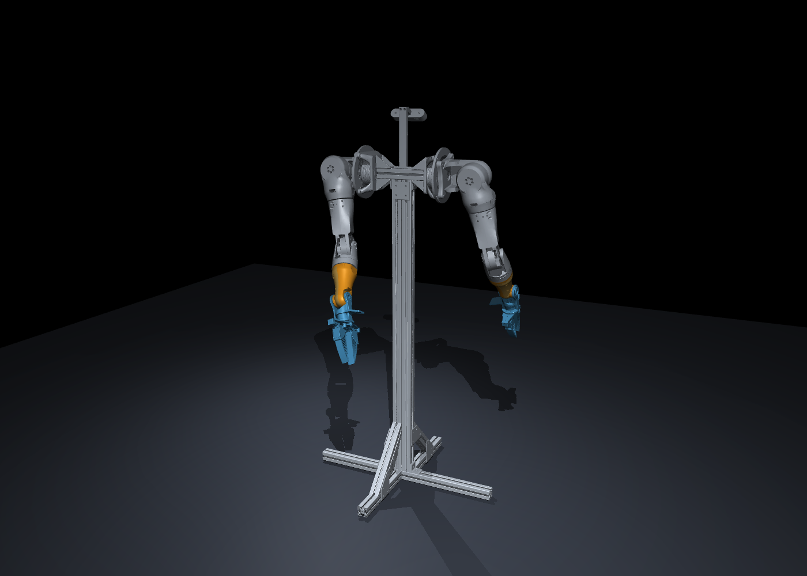

# Updated Arm V2: forearms, wrist/grippers and keyboard simulator

This is the complete dual-arm CAD assembly on its stand, updated with
`FOREARM-WRIST-SUPPORT-CLEARANCE.SLDPRT`,
`FOREARM-COVER-OPEN-WRIST-WINDOW.SLDPRT`, and both wrist/grippers from
`2026-10-27-14-38-00-077.step`. The opposite side is mirrored. It replaces the
previous `pioneer_bimanual_arm` export at the existing asset path.



## Open the keyboard simulator

From the repository root (Python 3.10+):

```bash
pip install -e 'src/pioneer_humanoid[mujoco]'
python -m pioneer_humanoid.arm_v2_keyboard
# or: pioneer-arm-keyboard
```

Linux also needs Tk (`python3-tk`) and a graphical display. In the existing
`simulation_mj` container the repository is mounted at `/workspace/humanoid`;
run the same command there with X forwarding configured by watod. Windows can
also double-click `simulation/Launch_Keyboard_Sim.cmd` (Python 3.11 launcher).

- `L` / `R`: select arm; `1`–`7`: select joint/gripper; `Tab`: next control.
- Left/right arrows: −/+1 degree; down/up arrows: −/+5 degrees.
- `Home`: zero selected; `Backspace`: restore CAD pose; `Space`: pause motion.
- All 14 controls also have sliders. Close either window to exit.

Each arm has six arm pivots and a gripper crank. Two rail sliders and two pin
hinges per arm follow the measured crank/linkage geometry. This gives 14
independent controls and 22 movable joints, with all 474 CAD components present.
The stand, covers and stationary motor housings remain rigidly attached.

The keyboard controller is **kinematic**. Its ranges are configurable preview
limits, not certified hardware stops. Masses, torque behavior, collisions and
grasping with the revised fingers need physical calibration/revalidation.

## Integration and compatibility

The URDF remains `urdf/pioneer_bimanual_arm.urdf` and retains the package name
`armv2URDF`. Existing `base_link`, `link1`–`link8`, `link1L`/`link2l`–`link8l`,
and `joint1`–`joint8`/left joint names remain available. Arm-axis signs and the
forward-X/left-Y, shoulder-height base frame follow the existing teleop interface.
The six new passive crank/pin coordinates have explicit names.

The old independent 50 mm jaw stroke is replaced by the approximately 40.5 mm
travel derived from the new mechanism. `arm_params`, finger-tip offsets and the
joint-limit loader use generated mechanism data. MuJoCo adds four closed-loop
pin connections, preserves the existing 16 actuator names for teleop, and resets
the passive crank/pin state with the arm. The keyboard UI controls the physical
crank rather than independently moving the jaws.

Isaac Lab now converts this URDF at spawn instead of loading an obsolete checked-in
USD. It adds four maximal-coordinate spherical pin constraints outside the tree
articulation. Its importer/PhysX behavior still requires validation in an Isaac
environment; the tested backend for this update is MuJoCo. Generated USD is ignored.
The separate whole-body humanoid assets are not regenerated by this update.

## Files and reproducibility

- `urdf/pioneer_bimanual_arm_portable.urdf`: relative mesh paths for non-ROS viewers.
- `simulation/articulated_arm_scene.xml`: portable MuJoCo inspection scene.
- `simulation/articulated_arm.py`: joint grouping, CAD pivots, analytic linkage,
  asset generation (`python .../articulated_arm.py`). Runtime loads do not rewrite assets.
- `simulation/validate_articulation.py`: individual joint motion and a 201-sample
  gripper sweep, including pin-closure residuals.
- `config/arm_v2_mechanism.json`: generated closed targets, finger tips and pin anchors.
- `build_manifest.json`: component provenance and rigid-group membership.

Meshes use meters. The 97 MB neutral STEP export is intentionally not duplicated
in Git; the simulation contains the exported component meshes and provenance.
