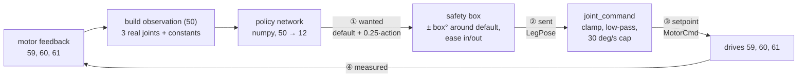

# Live walking policy on the right knee and ankle: does the leg do what the policy commands?

How to run the trained walking policy **live** on the right knee and the two right ankle motors:
real joint angles go into the policy, its joint targets go out to the motors every 20 ms. Every
link of that chain is logged, so you can measure whether the motors followed what the policy
commanded and, where they didn't, which link lost it.

Status as of 2026-11-19: Part A is done (A1 exported, A2 recorded, `policy_deploy.py` written and
self-tested). The script has also run end to end in software against the real `joint_command_node`
and fake motors, but **not on the leg**. Part B is blocked: every right-leg joint is still uncalibrated
(`zero_offset: null`) with zero gains, so the replay guide's B1–B5 come first. Companion guide: [`RIGHT_LEG_POLICY_REPLAY.md`](RIGHT_LEG_POLICY_REPLAY.md), which replays a
recorded sim walk instead. Its setup steps are reused here.

---

## 0. What this test is

The policy expects a whole robot standing on the floor. We give it 3 real joints and fill the other
47 inputs with honest constants (section 2). So **its output won't look like walking**, and nobody
should expect it to. It may twitch, hold still, or push one way. That's fine, because the test isn't
"does it walk". The test answers two questions:

1. **Does the deployment pipeline work?** Real feedback → observation → network → LegPose →
   `joint_command` → CAN → motors, at 50 Hz, with the right units, signs and joint order.
2. **Did the motors follow what was deployed?** And when they didn't, was it our safety box,
   `joint_command`'s limits, or the motor itself?

Both carry over unchanged to the full robot later. Only the observation gets more real.



### Before you start

- [ ] [`RIGHT_LEG_POLICY_REPLAY.md`](RIGHT_LEG_POLICY_REPLAY.md) **A1** (signs) and **B1–B5** (bus,
      direction, calibration, check, gains) are done for every joint you will run. Same gates apply:
      the ankle linkage question (D1) before the ankles, and knee gains that hold the shank before the knee.
- [ ] That guide's **section 1 checklist** before every powered step: E-stop in reach, thigh clamped
      vertical, foot clear of the floor, cables slack, `joint_command` restarted after the last
      yaml edit.

---

## 1. The four signals and the three gaps

This is the whole point of the test. Every tick, four angles per joint get logged:

| # | Signal | Means | Logged in | Column |
|---|---|---|---|---|
| ① | **wanted** | the policy's target: `default + 0.25 × action` | `policy.csv` | `wanted_<URDF name>`, e.g. `wanted_Ankle_P_R` |
| ② | **sent** | what we published on LegPose, after the safety box and ease-in | `telemetry.csv` | `sp_raw_deg` |
| ③ | **setpoint** | what `joint_command` sent the drive, after its clamp, low-pass and 30 deg/s cap | `telemetry.csv` | `sp_deg` |
| ④ | **measured** | where the joint really is | `telemetry.csv` | `pos_deg` |

The differences between neighbouring signals each have one cause:

| Gap | = | Caused by | Is it a problem? |
|---|---|---|---|
| **box gap** | ① − ② | our safety box (A3) | No. It's deliberate. It shows how hard the policy pushes. |
| **joint_command gap** | ② − ③ | limits, low-pass (~0.13 s lag), 30 deg/s cap | Expected when the policy asks for fast moves. The motors aren't involved. |
| **motor gap** | ③ − ④ | the drive and the leg: gains, gravity sag, friction, latency | **This is "did the motors follow"** |

"Did the motors follow what was deployed?" is answered by the **motor gap**, plus the **lag**
(how many ms ④ trails ③). The other two gaps explain why a motor didn't get what the policy wanted.
That isn't the motor's fault.

`telemetry.csv` already holds ②③④: `roundtrip.py`'s `TelemetryRecorder` subscribes to LegPose,
MotorCmd and MotorFeedback and writes them per motor per tick. `policy.csv` is new (A3).

---

## 2. What goes into the policy

The leg-only flat policy (`models/pioneer_leg_only_flat/model_2999.pt`) takes 50 numbers, in this
order, in raw units (no normalisation), every 20 ms:

| Slots | Input | Filled with | Why that value |
|---|---|---|---|
| 0–2 | base linear velocity, body frame (m/s) | `0, 0, 0` | the gantry holds the pelvis still: true |
| 3–5 | base angular velocity (rad/s) | `0, 0, 0` | true for the same reason |
| 6–8 | projected gravity | `0, 0, -1` | true if the pelvis is level: check it with a spirit level |
| 9–11 | command vx, vy, wz | `--vx --vy --wz` | your choice; start at 0 (stand) |
| 12–23 | joint angle − default (rad), 12 joints | **real** for each `--joints` joint; **0** (= at default) for the rest | 3 joints have motors; 9 don't |
| 24–35 | joint velocity (rad/s) | **real** (from the position, see below) for `--joints`; **0** for the rest | |
| 36–47 | last action | the network's own previous raw output | as in training |
| 48–49 | gait clock | `sin, cos` of 2π · (t mod 1 s), t from policy start | as in training |

Joint order (slots 12–23, 24–35, 36–47, and the 12 outputs) is the training order:

```
0 Hip_F_L   1 Hip_F_R   2 Hip_A_L   3 Hip_A_R   4 Hip_R_L   5 Hip_R_R
6 Knee_L    7 Knee_R    8 Ankle_P_L 9 Ankle_P_R 10 Ankle_R_L 11 Ankle_R_R
```

| Our joint | Index | LegPose slot | Motor | Default (rad / deg) |
|---|---|---|---|---|
| right knee.pitch | 7 (`Knee_R`) | `knee.position[0]` | 59 | -0.5 / -28.65 |
| right ankle.pitch | 9 (`Ankle_P_R`) | `ankle.position[0]` | 60 | -0.25 / -14.32 |
| right ankle.roll | 11 (`Ankle_R_R`) | `ankle.position[1]` | 61 | 0 / 0 |

**Units.** Feedback (via `RoundTripNode.measured()`) is in command-frame degrees. After the replay
guide's B2/B3 that *is* the URDF angle, so `q_rel = radians(measured) - default`, with no sign flips.

**Velocity.** The drives' velocity isn't in the feedback (`telemetry.csv`'s `vel_dps` is blank),
so take the difference of successive positions over the real tick time. Positions come in 0.1°
steps. At 50 Hz one step reads as 5 deg/s (0.09 rad/s) of noise. Smooth it lightly:
`qd = 0.5·qd_prev + 0.5·raw`.

**Output.** 12 numbers. Target for joint j = `default[j] + 0.25 × action[j]` (rad). We use indices
7, 9 and 11 for the joints in `--joints` and drop the rest.

---

## 3. Part A: offline, no hardware

### A1. Export the network so the robot can run it

The robot containers have numpy (1.21) but **no torch** (checked in the `legs-benching` images). The
policy is a small MLP (50 → 256 → 128 → 128 → 12, ELU), so numpy runs it in well under a
millisecond. Export the weights once on the host, and check that numpy gives the same answers as torch:

```bash
mkdir -p outputs/policy
uv run --with torch --with numpy python - <<'EOF'
import numpy as np, torch
src = "models/pioneer_leg_only_flat/model_2999.pt"
state = torch.load(src, map_location="cpu")["model_state_dict"]
assert not [k for k in state if "normalizer" in k], "checkpoint normalises observations: this export would be wrong"
keys = sorted((k for k in state if k.startswith("actor.") and k.endswith(".weight")), key=lambda k: int(k.split(".")[1]))
W = [state[k].numpy().astype(np.float64) for k in keys]
B = [state[k.replace("weight", "bias")].numpy().astype(np.float64) for k in keys]

def mlp(x):                       # what policy_deploy.py will run
    for i, (w, b) in enumerate(zip(W, B)):
        x = w @ x + b
        if i < len(W) - 1:
            x = np.where(x > 0, x, np.expm1(x))     # ELU
    return x

layers = []                       # the torch actor, built as sim2sim_mujoco.py's load_actor does
for i, k in enumerate(keys):
    lin = torch.nn.Linear(*reversed(state[k].shape))
    lin.weight.data, lin.bias.data = state[k], state[k.replace("weight", "bias")]
    layers += [lin] + ([torch.nn.ELU()] if i < len(keys) - 1 else [])
actor = torch.nn.Sequential(*layers).eval()

x = np.random.default_rng(0).normal(size=(1000, 50))
with torch.no_grad():
    ref = actor(torch.from_numpy(x).float()).numpy()
err = max(np.abs(mlp(v) - r).max() for v, r in zip(x, ref))
print("layers", [w.shape for w in W], " max |numpy - torch| =", err)
assert err < 1e-4

def standing_obs(vx):             # = sim2sim_mujoco.py's very first observation
    o = np.zeros(50); o[8] = -1.0; o[9] = vx; o[49] = 1.0
    return o
ref_obs = np.stack([standing_obs(0.0), standing_obs(0.3)])
ref_act = np.stack([mlp(o) for o in ref_obs])
print("first action, vx 0  :", ref_act[0].round(3))
print("first action, vx 0.3:", ref_act[1].round(3))
np.savez("outputs/policy/leg_only_flat_2999.npz", n=len(W),
         **{f"w{i}": w for i, w in enumerate(W)}, **{f"b{i}": b for i, b in enumerate(B)},
         ref_obs=ref_obs, ref_act=ref_act)
EOF
```

| Check | Expect | Got |
|---|---|---|
| layer shapes | (256, 50), (128, 256), (128, 128), (12, 128) | same ✓ |
| max \|numpy − torch\| | < 1e-4 | 1.5e-5 ✓ |
| first action, vx 0: largest \|value\| | small (≲ 1, i.e. ≲ 14° from default) | 1.45 (Knee_L); Knee_R 1.36 (+19.5°), Ankle_P_R 0.22, Ankle_R_R −0.29. Slightly over; both knees want to straighten |

`ref_obs`/`ref_act` are the robot standing still at the default pose: exactly the first observation
`sim2sim_mujoco.py` builds. In A3 the node rebuilds that observation with its own code and must get
the same action. That catches a wrong slot order or a missing `-1` on gravity.

`outputs/` is gitignored and mounted at `/outputs` in the `joint_command` container.

### A2. Know what "standing" looks like in sim

So you can tell later whether the real leg's behaviour at vx 0 is odd:

```bash
uv run --with mujoco --with torch --with numpy --with imageio --with imageio-ffmpeg python \
    src/simulation/humanoid_rl_tasks/humanoid_rl_tasks/locomotion/config/pioneer/sim2sim_mujoco.py \
    models/pioneer_leg_only_flat/model_2999.pt --vx 0 --seconds 10 --video outputs/policy/stand.mp4
```

Watch the video. Does the policy stand still at vx 0, or step in place (the gait clock keeps ticking)?
Write it down; it's what a "healthy" live run at vx 0 is aiming at.

2026-11-19: 10 s without falling, base drift 3 cm. Frames show the legs trading places, so it seems
to **step in place** rather than stand still. Confirm by watching `outputs/policy/stand.mp4`.

### A3. Write `policy_deploy.py`

A new script next to `roundtrip.py` in `src/interfacing/can/scripts/` (mounted at
`/opt/humanoid_scripts` in the `joint_command` container). It reuses `roundtrip.py`'s
`RoundTripNode` (LegPose publisher, feedback, `telemetry.csv` logging), `resolve_config`, `cosine`
and `profile_time`, and its Ctrl-C / lost-feedback / tracking-error handling. New: the observation,
the network, the safety box and `policy.csv`.

```text
policy_deploy.py --weights /outputs/policy/leg_only_flat_2999.npz --side right
                 --joints ankle.pitch              # real joints: fed into the policy AND driven
                 --vx 0 --vy 0 --wz 0
                 --box 5                           # deg: sent stays within default +- box
                 --seconds 20 --ease 3             # policy run length; ease in/out, s
                 [--max-track-err 8] [--feedback-timeout 0.5] [--limit-margin 2] [--label]
                 [--self-test]                     # no ROS: rebuild ref_obs, compare ref_act, print, exit
                 [--check]                         # preflight against live feedback, publish nothing
                 [--motor-cmd-topic /dry_run/motorCMD]   # dry run
```

```text
JOINTS  = [Hip_F_L, Hip_F_R, ..., Ankle_R_R]                  # section 2 order
DEFAULT = {Hip_F: 0.25, Knee: -0.5, Ankle_P: -0.25, else 0}    # rad
IDX     = {knee.pitch: 7, ankle.pitch: 9, ankle.roll: 11}      # right leg
SLOT    = {knee.pitch: 3, ankle.pitch: 4, ankle.roll: 5}       # LegPose 6-slot order

function build_obs(q_rel, qd, last_action, t, cmd):            # q_rel, qd: 12 each, 0 = missing
    phase = (t mod 1.0) / 1.0
    return [0,0,0, 0,0,0, 0,0,-1, cmd, q_rel, qd, last_action, sin(2 pi phase), cos(2 pi phase)]

--self-test: obs = build_obs(zeros, zeros, zeros, 0, (vx,0,0)) for vx in 0, 0.3;
             assert it equals ref_obs and mlp(obs) equals ref_act (1e-6); print the obs with
             slot names; exit

preflight (refuse and move nothing on any failure):
    feedback fresh from every --joints joint; each active, calibrated, inside its limits
    origin = measured; default_deg = degrees(DEFAULT) for the --joints joints
    default_deg +- box must fit inside [lo + margin, hi - margin], else refuse
    approach ramp origin -> default_deg (cosine, profile_time, <= 10 deg/s)
    print: joint, origin, default, box, limits, the command, E-STOP line
    --check: exit here

refuse also if the joints active in leg_actuators.yaml are not exactly --joints
phases: seed 2 s at origin (joint_command's setpoint must match measured, as roundtrip.py's hold)
    -> approach -> hold 2 s at default -> policy (--seconds) -> hold 2 s -> retreat to origin
    (TelemetryRecorder.phase = the phase name, so telemetry.csv rows are labelled)

policy phase, every 20 ms (timer):
    t  = time since the policy phase started;  dt = time since the last tick
    for j in --joints:
        q   = radians(measured(j)) - DEFAULT[j];  qd = 0.5 qd_prev + 0.5 (q - q_prev) / dt
    action  = mlp(build_obs(q_rel, qd, last_action, t, cmd));  last_action = action
    wanted  = degrees(DEFAULT + 0.25 action)  for the --joints joints
    env     = cosine ease 0->1 over the first --ease s, 1->0 over the last --ease s
    sent    = default_deg + env * clip(wanted - default_deg, -box, +box)
    sent    = clip(sent, lo + margin, hi - margin)
    publish LegPose: sent in the --joints slots, measured pose in the others (joint_command
            ignores inactive joints)
    policy.csv row: t_s (same clock as telemetry.csv), dt_ms, obs[50], action[12],
                    wanted_<URDF name>, sent_<URDF name>   (e.g. wanted_Ankle_P_R)

stops (same as roundtrip.py):
    Ctrl-C, or |measured - joint_command setpoint| > --max-track-err
        -> policy stops; cosine ramp from the last sent to default, then to origin
    second Ctrl-C -> stop streaming (joint_command's stale-stream handling takes over)
    feedback older than --feedback-timeout -> freeze: keep publishing the last sent; "support the leg"
at the end: print dt stats (median, 99th percentile, ticks > 25 ms) and the run folder
```

Why the box is in degrees around the **default pose**: the policy's outputs are offsets from that
pose, so the box limits exactly what the policy controls. The policy still sees and learns from its
own raw action (`last_action`). The box changes what the leg does, not what the policy thinks it
asked for. That's why ① and ② are logged separately.

Then, on the host (no ROS needed for `--self-test`):

```bash
uv run --with numpy python src/interfacing/can/scripts/policy_deploy.py \
    --weights outputs/policy/leg_only_flat_2999.npz --self-test
```

Pass: both reference actions match, and the printed observation shows `-1` at slot 8, the command
at 9–11 and `1` at slot 49. Import `rclpy` only after `--self-test` has been handled, so this runs on
the host.

---

## 4. Part B: on the leg

Containers and restart rules as in the replay guide's Part B: `./watod up -d`; yaml edits apply on
`./watod restart joint_command`; shells via `./watod -t joint_command`. Every command below runs in
that shell after `source /opt/watonomous/setup.bash`.

### B1. Config

- `joint_command.yaml`: `legs: ["right"]` (put it back to `["left"]` afterwards).
- `leg_actuators.yaml`, `right:`: `active: true` **only** for the joints in this stage's `--joints`
  (stage table in B4), with the gains that passed the replay guide's B5.
- `./watod restart joint_command`. Note `git log -1 --oneline` in the run table.

### B2. Preflight only

```bash
python3 /opt/humanoid_scripts/policy_deploy.py --weights /outputs/policy/leg_only_flat_2999.npz \
    --side right --joints ankle.pitch --vx 0 --box 5 --check
```

Nothing moves. Check the printed origin against `leg_angles.py` and that default ± box sits inside
the limits.

### B3. Dry run

**Question:** does the whole loop run at 50 Hz and produce the four signals, against real feedback,
with nothing moving?

1. `joint_command.yaml`: swap the two `motor_cmd_topic` lines so `/dry_run/motorCMD` is active.
   `./watod restart joint_command`.
2. The B2 command without `--check`, plus `--motor-cmd-topic /dry_run/motorCMD`.
3. Expect: the leg doesn't move; ④ stays flat; ② wanders inside the box; ③ follows ② smoothed and
   speed-capped. Because ④ never moves, the policy sees a joint that ignores it, so its output can
   drift to the box edge. That's fine here.
4. Run the analysis (section 5) on the dry-run folder. It must produce numbers for ①②③. The motor
   gap will be large: nothing moved.
5. Swap `motor_cmd_topic` back. `./watod restart joint_command`.

| Check | Expect | Got |
|---|---|---|
| ticks with dt > 25 ms | < 1 % | |
| `policy.csv` and `telemetry.csv` both written, same run folder | yes | |
| ③ never steeper than 0.6° per tick (30 deg/s) | yes | |

### B4. Live, one stage at a time

Every stage: section 0 checklist → `--check` → live. Within a stage, step through the rows top to
bottom; go to the next row only when the current one passes (B5). Person at the keyboard has
Ctrl-C; second person has the E-stop.

| Stage | `--joints` (= `active: true`) | Needs |
|---|---|---|
| 1 | `ankle.pitch` | replay-guide gates for 60 |
| 2 | `ankle.roll` | the same for 61 |
| 3 | `ankle.pitch,ankle.roll` | 1 and 2 pass |
| 4 | `knee.pitch` | knee holds the shank at -28.65° ± box (replay guide B5 table) |
| 5 | `knee.pitch,ankle.pitch,ankle.roll` | 3 and 4 pass |

| Row | `--vx` | `--box` | `--seconds` |
|---|---|---|---|
| a | 0 | 5 | 20 |
| b | 0 | 10 | 30 |
| c | 0.3 | 10 | 30 |
| d | 0.3 | 20 | 60 |

Live command (stage 1, row a):

```bash
python3 /opt/humanoid_scripts/policy_deploy.py --weights /outputs/policy/leg_only_flat_2999.npz \
    --side right --joints ankle.pitch --vx 0 --box 5 --seconds 20 --label s1a
```

Stop at once (Ctrl-C) if the joint **oscillates with growing amplitude**. The policy now reacts to
its own joint through ~0.1–0.2 s of lag (low-pass + speed cap + drive), and a feedback loop with
lag can ring. The box caps how far that goes. Note the frequency for the run table.

| Run | Commit | Stage/row | Ran to end? | Faults | dt > 25 ms | Oscillation (Hz, deg) | Notes |
|---|---|---|---|---|---|---|---|
| | | | | | | | |

---

## 5. Part C: did the motors follow?

On the host, per run folder (`outputs/policy/<run>/`, printed at the end of the run):

```bash
uv run --with matplotlib --with numpy tools/gl40_telemetry_plot.py <run>     # standard plots: ③ vs ④
uv run --with matplotlib --with numpy python - <run> <<'EOF'
import csv, sys
import numpy as np, matplotlib.pyplot as plt
run = sys.argv[1]
URDF = {"knee.pitch": "Knee_R", "ankle.pitch": "Ankle_P_R", "ankle.roll": "Ankle_R_R"}
tel = [r for r in csv.DictReader(open(f"{run}/telemetry.csv")) if r["phase"] == "policy"]
pol = np.genfromtxt(f"{run}/policy.csv", delimiter=",", names=True)
f = lambda rows, c: np.array([float(r[c]) if r[c] else np.nan for r in rows])
rms = lambda x: np.sqrt(np.nanmean(x ** 2))
fig, axes = plt.subplots(3, 1, sharex=True, figsize=(12, 9))
print(f"{'joint':12s} {'box gap':>14s} {'jc gap':>14s} {'motor gap':>14s} {'lag ms':>7s} {'boxed %':>8s}   (gaps: rms / max deg)")
for ax, (joint, urdf) in zip(axes, URDF.items()):
    rows = [r for r in tel if r["joint"].endswith(joint)]
    if not rows or f"wanted_{urdf}" not in pol.dtype.names:
        continue
    t, sent, sp, pos = f(rows, "t_s"), f(rows, "sp_raw_deg"), f(rows, "sp_deg"), f(rows, "pos_deg")
    wanted = np.interp(t, pol["t_s"], pol[f"wanted_{urdf}"])
    gaps = [wanted - sent, sent - sp, sp - pos]
    lags = [rms(sp[:len(sp) - k] - pos[k:]) for k in range(26)]          # 0-0.5 s at 50 Hz
    lag_ms = 20 * int(np.nanargmin(lags))
    boxed = 100 * np.nanmean(np.abs(gaps[0]) > 0.05)
    print(f"{joint:12s}" + "".join(f" {rms(g):6.2f} / {np.nanmax(np.abs(g)):5.1f}" for g in gaps)
          + f" {lag_ms:7d} {boxed:7.0f}%")
    for y, name in zip([wanted, sent, sp, pos], ["① wanted", "② sent", "③ setpoint", "④ measured"]):
        ax.plot(t, y, label=name)
    ax.set_ylabel(f"{joint} (deg)"); ax.legend(loc="upper right", fontsize=8)
axes[-1].set_xlabel("t (s)")
fig.savefig(f"{run}/follow.png", dpi=120)
print("dt ms: median %.1f, 99%% %.1f" % tuple(np.percentile(pol["dt_ms"], [50, 99])))
EOF
```

It prints one row per joint and saves `follow.png` with the four curves.

| Run | Joint | box gap rms/max | jc gap rms/max | **motor gap rms/max** | **lag ms** | boxed % | Predicted sag (torque/kp) |
|---|---|---|---|---|---|---|---|
| | | | | | | | |

### Reading it

| You see | Means | Do |
|---|---|---|
| Motor gap rms ≤ ~2° beyond the predicted sag, lag tens of ms | **the motors followed what was deployed** | next row |
| Motor gap is a constant offset | gravity sag (compare torque/kp) or a zero error | replay guide B4/B5 |
| Motor gap only at turn-arounds, lag ≳ 100 ms | the drive is slow for these gains | record the lag; it's a number the sim must eventually include |
| Motor gap grows over the run | heating or loosening | `temperature.png`; check the mounting |
| ④ moves opposite to ③ | direction wrong | E-stop; replay guide B2–B4 |
| Big jc gap, ③ climbing at exactly 30 deg/s | the policy asks for faster moves than the cap allows | expected; not a motor fault; don't raise the cap for this test |
| Big box gap, boxed % near 100 | the policy pushes past the box all the time | expected with these inputs; widen the box only by the row table |
| ② swings edge to edge at a steady frequency | closed-loop ringing: policy ↔ joint through the lag | keep the box small; note the frequency |
| dt median far from 20 ms or 99 % > 25 ms | the node is late; every other number is suspect | fix timing first (CPU load, logging) |
| `joint_command` fault in the log | read its text | fix the cause; never raise a limit to get past it |

A row **passes** when the run reaches the end with no fault, the motor gap is as in the first line
of the table, and dt is on time. The whole test passes when stage 5 row d passes: then the
deployment chain is proven for these three joints, and the measured lag and gaps are the numbers
to bring back to the sim.

---

## 6. What this does and doesn't show

**Shows:** the policy runs on the robot computer in time; its observation is built in the right
order and units; its outputs reach the right motors with the right signs; and how faithfully, and
with what lag, the motors follow `joint_command`'s setpoints under policy-driven motion.

**Doesn't show:** that the policy walks, or that its outputs are good. They're responses to a robot
that is mostly constants. Also, the sim joints that trained the policy were PD loops with kp 200
(knee) and 40 (ankle). The real gains are much lower, so the same action produces less torque on
the real leg. Closing that gap (gains, or retraining on the real actuator) is a separate step, and
the motor-gap and lag numbers from this test feed it.

**HARDWARE E-STOP on the 48 V leg supply within reach for every powered step.** A software stop is
not a substitute.
