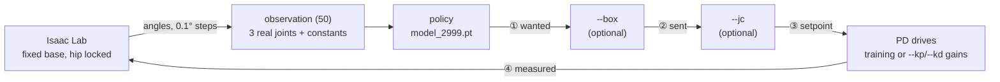

# Live walking policy on the right leg, in sim first (Isaac Lab)

How to run the walking policy in Isaac Lab on a **simulated copy of the right-leg gantry rig**, with
exactly the inputs from [`RIGHT_LEG_POLICY_LIVE.md`](RIGHT_LEG_POLICY_LIVE.md) section 2: 3 real
joints, and the other 47 inputs filled with the same constants. You see what the leg will do before
any motor moves, and you get the same log files as a real run, so the live guide's Part C analysis
works on both.

Status as of 2026-11-18, written from the code on `locomotion-policy` (076b4e41). **Nothing here has
run.** The script in step 2 is new. I've only checked that it parses as Python; it hasn't run in Isaac
Lab yet. The parts most likely to need a fix on first run are marked ⚠.

**Update 2026-11-19:** runs r1–r7 are done and saved in `outputs_lucas/` (commit bc775866). r1 and r7
each have two folders. Use the complete one: `20261119-031530_r1` and `20261119-045901_r7`. To judge
them, read **section 6** (the ideas behind the numbers, from first principles), then run **section 7**
(a health check per run, and what the sim has to show before each live stage).

---

## 0. What this shows

The rig, and what each part of it becomes in sim:

| Real rig (live guide) | In sim (this guide) |
|---|---|
| Gantry holds the pelvis still | Robot base fixed in the air, 1.0 m up, so the foot hangs ~15 cm off the floor |
| Right thigh clamped vertical | Right hip pitch, roll and yaw locked at 0 (thigh vertical) |
| Left leg not driven | Left leg locked at the default pose. It doesn't affect the right leg: base fixed, no self-collision |
| Motors 59, 60, 61 | `Knee_R`, `Ankle_P_R`, `Ankle_R_R`, PD-driven like the training robot |
| Feedback: positions in 0.1° steps, no velocity | Sim angles rounded to 0.1°, velocity by differencing, then smoothed (same as `policy_deploy.py`) |
| Section 2 observation | Built the same way, slot for slot |
| Safety box + ease in/out | `--box`, `--ease` |
| `joint_command` (clamp, low-pass, 30 deg/s cap) | `--jc` |
| Real MIT gains | `--kp`, `--kd` |



The four signals ① to ④ are the same ones as in the live guide's section 1, with the same column
names in the same CSV files.

**What to expect.** Walking needs the floor, the hips, balance and the other leg. This rig has none of
those, so it **won't walk**. The best you'll see is the knee and ankle going through a stepping
motion in the air, at the gait clock's 1 s rhythm. You may also see nothing, a twitch, or a joint
pushed to one side. Every one of those is a useful answer: it's what the real leg will be asked to do.

---

## 1. Before you start

- [ ] The Isaac container runs and shows a window. On the host: `xhost +local:docker`, `./watod up -d`,
      then `./watod -t simulation_isaac` for a shell. Setup: `docker/simulation/isaac_lab/README.md`.
- [ ] Optional: the live guide's step **A1** has run. Note its printed `first action, vx 0`. Step 3
      compares against it.

### 1a. See the normal walk first

So you know what the policy does when it has everything it was trained with. In the container:

```bash
export PLAY_COMMAND=0.3,0,0
rl-play --task=Isaac-Locomotion-Flat-PioneerLegOnly-Play-v0 --num_envs 1 \
    --checkpoint models/pioneer_leg_only_flat/model_2999.pt
```

Use `export`. Writing `PLAY_COMMAND=... rl-play` on one line doesn't work: `rl-play` is an alias that
starts with `cd`, so the variable would go to `cd` and not to the play script.

Watch the **right knee and ankle** for a few strides: how far the knee bends in swing, how the ankle
lifts the toe. That's the motion the rig runs below are trying to show in the air. Close the window
when you're done.

---

## 2. Save the script

Save this as
`src/simulation/humanoid_rl_tasks/humanoid_rl_tasks/locomotion/config/pioneer/rig_policy_isaac.py`,
next to `sim2sim_mujoco.py`. The repo is mounted into the container, so the file shows up there too.

```python
"""The leg-only walking policy on a simulated right-leg gantry rig (Isaac Lab).

What explainers/RIGHT_LEG_POLICY_LIVE.md will run on the real leg, in sim: the pelvis is fixed in the air,
the right hip is clamped, and only the right knee and ankle are driven. The policy gets the observation of
that guide's section 2: real angles and velocities for --joints, constants for everything else.
Writes telemetry.csv and policy.csv in the live run's format, so its Part C analysis runs unchanged.

    $ISAACLAB/isaaclab.sh -p <this file> models/pioneer_leg_only_flat/model_2999.pt --vx 0
"""
import argparse
import csv
import math
import os
import time
from datetime import datetime

from isaaclab.app import AppLauncher

RIG = {"knee.pitch": "Knee_R", "ankle.pitch": "Ankle_P_R", "ankle.roll": "Ankle_R_R"}
MOTOR = {"knee.pitch": 59, "ankle.pitch": 60, "ankle.roll": 61}

p = argparse.ArgumentParser(description=__doc__.split("\n")[0])
p.add_argument("checkpoint")
p.add_argument("--joints", default="knee.pitch,ankle.pitch,ankle.roll", help="driven and fed to the policy; the rest are locked")
p.add_argument("--vx", type=float, default=0.0)
p.add_argument("--vy", type=float, default=0.0)
p.add_argument("--wz", type=float, default=0.0)
p.add_argument("--seconds", type=float, default=20.0, help="policy phase length; 2 s holds at default before and after")
p.add_argument("--box", type=float, default=0.0, help="deg around default, with ease in/out (as policy_deploy.py); 0 = no box")
p.add_argument("--ease", type=float, default=3.0, help="s, only with --box")
p.add_argument("--jc", action="store_true", help="add joint_command's clamp, low-pass and 30 deg/s cap after the box")
p.add_argument("--kp", type=float, nargs=3, metavar=("KNEE", "ANKLE_P", "ANKLE_R"), help="drive gains, N.m/rad (default: training's)")
p.add_argument("--kd", type=float, nargs=3, metavar=("KNEE", "ANKLE_P", "ANKLE_R"), help="N.m.s/rad")
p.add_argument("--label", default="")
AppLauncher.add_app_launcher_args(p)
args = p.parse_args()
joints = args.joints.split(",")
assert set(joints) <= set(RIG), f"--joints must be from {list(RIG)}"
app = AppLauncher(args).app

import numpy as np  # noqa: E402
import torch  # noqa: E402

import isaaclab.sim as sim_utils  # noqa: E402
from isaaclab.actuators import ImplicitActuatorCfg  # noqa: E402
from isaaclab.assets import AssetBaseCfg  # noqa: E402
from isaaclab.scene import InteractiveScene, InteractiveSceneCfg  # noqa: E402
from isaaclab.utils import configclass  # noqa: E402

from pioneer_humanoid.leg_only import LEG_ONLY_HUMANOID_CFG  # noqa: E402

REPO = os.path.abspath(os.path.join(os.path.dirname(__file__), *[".."] * 7))
JOINTS = ["Hip_F_L", "Hip_F_R", "Hip_A_L", "Hip_A_R", "Hip_R_L", "Hip_R_R", "Knee_L", "Knee_R", "Ankle_P_L", "Ankle_P_R", "Ankle_R_L", "Ankle_R_R"]
DEFAULT = np.array([{"Hip_F": 0.25, "Knee": -0.5, "Ankle_P": -0.25}.get(j[:-2], 0.0) for j in JOINTS])
KP = {"Knee_R": 200.0, "Ankle_P_R": 40.0, "Ankle_R_R": 40.0}  # training's (leg_only.py)
KD = {"Knee_R": 5.0, "Ankle_P_R": 2.0, "Ankle_R_R": 2.0}
EFFORT = {"Knee_R": 222.0, "Ankle_P_R": 60.0, "Ankle_R_R": 60.0}
HIP_PITCH = 0.0  # rad: the gantry clamps the thigh vertical. The policy is still told it is at default (0.25)
BASE_Z = 1.0  # m: hips 0.848 m above the soles with straight legs, so the foot hangs ~15 cm off the floor
DT, SUBSTEPS = 0.02, 4  # policy tick; physics at 5 ms, as in training
ALPHA, STEP = 0.85, 0.6  # leg_actuators.yaml global: low_pass_alpha; velocity_max 30 deg/s = 0.6 deg per tick

drive = [RIG[j] for j in joints]
d = [JOINTS.index(n) for n in drive]  # policy indices: 7, 9, 11
kp = dict(zip(RIG.values(), args.kp)) if args.kp else KP
kd = dict(zip(RIG.values(), args.kd)) if args.kd else KD
spawn = LEG_ONLY_HUMANOID_CFG.spawn
robot_cfg = LEG_ONLY_HUMANOID_CFG.replace(
    prim_path="{ENV_REGEX_NS}/Robot",
    # own USD folder: a fixed-base conversion must not overwrite the one training uses
    spawn=spawn.replace(fix_base=True, usd_dir=spawn.usd_dir + "_rig"),
    init_state=LEG_ONLY_HUMANOID_CFG.init_state.replace(
        pos=(0.0, 0.0, BASE_Z), joint_pos={**dict(zip(JOINTS, DEFAULT.tolist())), "Hip_F_R": HIP_PITCH}),
    actuators={
        "rig": ImplicitActuatorCfg(joint_names_expr=drive, stiffness={n: kp[n] for n in drive}, damping={n: kd[n] for n in drive},
                                   effort_limit_sim={n: EFFORT[n] for n in drive}, armature=0.01),
        # everything else held where it is, like the clamp (hip) or a joint that isn't in this run
        "locked": ImplicitActuatorCfg(joint_names_expr=[n for n in JOINTS if n not in drive], stiffness=1.0e4, damping=1.0e2,
                                      effort_limit_sim=1.0e4, armature=0.01),
    },
)


@configclass
class RigSceneCfg(InteractiveSceneCfg):
    ground = AssetBaseCfg(prim_path="/World/ground", spawn=sim_utils.GroundPlaneCfg())
    light = AssetBaseCfg(prim_path="/World/light", spawn=sim_utils.DomeLightCfg(intensity=1000.0, color=(0.75, 0.75, 0.78)))
    robot = robot_cfg


def load_actor(path: str) -> torch.nn.Module:
    """sim2sim_mujoco.py's: the actor MLP (ELU, no observation normalisation) of an rsl_rl checkpoint."""
    state = torch.load(path, map_location="cpu")["model_state_dict"]
    weights = sorted((k for k in state if k.startswith("actor.") and k.endswith(".weight")), key=lambda k: int(k.split(".")[1]))
    layers = []
    for i, k in enumerate(weights):
        linear = torch.nn.Linear(*reversed(state[k].shape))
        linear.weight.data, linear.bias.data = state[k], state[k.replace("weight", "bias")]
        layers += [linear] + ([torch.nn.ELU()] if i < len(weights) - 1 else [])
    return torch.nn.Sequential(*layers).eval()


def main() -> None:
    sim = sim_utils.SimulationContext(sim_utils.SimulationCfg(dt=DT / SUBSTEPS, render_interval=SUBSTEPS, device=args.device))
    sim.set_camera_view((0.5, -1.8, 0.8), (0.0, -0.15, 0.5))  # from the robot's right, at knee height
    scene = InteractiveScene(RigSceneCfg(num_envs=1, env_spacing=2.0))
    sim.reset()
    robot = scene["robot"]
    ids = robot.find_joints(JOINTS, preserve_order=True)[0]  # sim index of each JOINTS entry
    sim_d = [ids[i] for i in d]
    robot.write_joint_state_to_sim(robot.data.default_joint_pos.clone(), robot.data.default_joint_vel.clone())
    robot.reset()
    lo, hi = np.degrees(robot.data.joint_pos_limits[0, sim_d].cpu().numpy()).T
    actor = load_actor(args.checkpoint)

    run = os.path.join(REPO, "outputs", "policy_sim", datetime.now().strftime("%Y%m%d-%H%M%S") + (f"_{args.label}" if args.label else ""))
    os.makedirs(run)
    tel_file = open(os.path.join(run, "telemetry.csv"), "w", newline="")
    pol_file = open(os.path.join(run, "policy.csv"), "w", newline="")
    tel = csv.writer(tel_file)
    tel.writerow(["t_s", "source", "motor_id", "joint", "phase", "sp_deg", "sp_raw_deg", "pos_deg", "tau_nm", "kp"])
    pol = csv.writer(pol_file)
    pol.writerow(["t_s", "dt_ms"] + [f"obs_{i}" for i in range(50)] + [f"act_{i}" for i in range(12)]
                 + [f"wanted_{n}" for n in drive] + [f"sent_{n}" for n in drive])

    default_deg = np.degrees(DEFAULT[d])
    cmd = np.array([args.vx, args.vy, args.wz])
    hold = int(2.0 / DT)
    phases = ["hold"] * hold + ["policy"] * int(args.seconds / DT) + ["hold"] * hold
    targets = robot.data.default_joint_pos.clone()  # locked joints stay at their start angle
    action, qd, q_prev, sp = np.zeros(12), np.zeros(len(d)), None, None
    for k, phase in enumerate(phases):
        if not app.is_running():
            break
        wall = time.time()
        # what the drives report: command-frame degrees in 0.1 deg steps, no velocity
        meas = np.round(np.degrees(robot.data.joint_pos[0, sim_d].cpu().numpy()) * 10.0) / 10.0
        q = np.radians(meas) - DEFAULT[d]
        if q_prev is not None:
            qd = 0.5 * qd + 0.5 * (q - q_prev) / DT
        q_prev = q
        if phase == "policy":
            t = (k - hold) * DT  # gait clock starts with the policy
            q_rel, qd_rel = np.zeros(12), np.zeros(12)
            q_rel[d], qd_rel[d] = q, qd
            obs = np.concatenate([[0, 0, 0, 0, 0, 0, 0, 0, -1.0], cmd, q_rel, qd_rel, action,
                                  [math.sin(2 * math.pi * (t % 1.0)), math.cos(2 * math.pi * (t % 1.0))]])
            with torch.no_grad():
                action = actor(torch.from_numpy(obs.astype(np.float32))[None]).numpy()[0].astype(float)
            if k == hold:
                print("first action:", action.round(3))
            wanted = np.degrees(DEFAULT + 0.25 * action)[d]
            sent = wanted
            if args.box:
                x = min(t / args.ease, (args.seconds - t) / args.ease, 1.0)
                sent = default_deg + (0.5 - 0.5 * math.cos(math.pi * max(x, 0.0))) * np.clip(wanted - default_deg, -args.box, args.box)
            pol.writerow([f"{k * DT:.4f}", f"{DT * 1000:.1f}"] + [f"{v:.5f}" for v in np.concatenate([obs, action, wanted, sent])])
        else:
            sent = default_deg
        if args.jc:  # joint_command_core.cpp: clamp, low-pass, then the per-tick step cap
            target = np.clip(sent, lo, hi)
            if sp is not None:
                target = ALPHA * sp + (1.0 - ALPHA) * target
                target = sp + np.clip(target - sp, -STEP, STEP)
            sp = target
        else:
            sp = sent
        targets[0, sim_d] = torch.tensor(np.radians(sp), dtype=targets.dtype, device=targets.device)
        robot.set_joint_position_target(targets)
        for _ in range(SUBSTEPS):
            scene.write_data_to_sim()
            sim.step(render=False)
            scene.update(DT / SUBSTEPS)
        sim.render()
        pos = np.degrees(robot.data.joint_pos[0, sim_d].cpu().numpy())
        tau = robot.data.applied_torque[0, sim_d].cpu().numpy()
        for i, j in enumerate(joints):
            tel.writerow([f"{k * DT:.4f}", "sim", MOTOR[j], j, phase, f"{sp[i]:.4f}", f"{sent[i]:.4f}", f"{pos[i]:.4f}",
                          f"{tau[i]:.5f}", f"{kp[drive[i]]:.4f}"])
        if not args.headless:
            time.sleep(max(0.0, DT - (time.time() - wall)))  # real time, so you can watch it
    tel_file.close()  # before app.close(), which may exit without flushing
    pol_file.close()
    print(f"run folder: {run}")


if __name__ == "__main__":
    main()
    app.close()
```

### Where section 2 lives in the script

| Section 2 row | In the script |
|---|---|
| base velocities = 0, gravity = (0, 0, −1) | `obs = np.concatenate([[0, 0, 0, 0, 0, 0, 0, 0, -1.0], ...` |
| command vx, vy, wz | `cmd`, from `--vx --vy --wz` |
| joint angle − default: real for `--joints`, 0 for the rest | `q_rel[d] = q` (the rest stay 0) |
| joint velocity: differenced and smoothed | `qd = 0.5 * qd + 0.5 * (q - q_prev) / DT` |
| last action: the network's own raw output | `action` from the previous tick |
| gait clock, t from policy start | `t = (k - hold) * DT` |
| target = default + 0.25 × action, keep 7, 9, 11 | `wanted = np.degrees(DEFAULT + 0.25 * action)[d]` |

### The run, tick by tick

1. **Hold, 2 s.** The rig joints are held at the default pose. The policy isn't running yet. Gravity
   pulls the shank a little off default (see 3b).
2. **Policy, `--seconds`.** Every 20 ms: read the 3 joints, build the observation, run the network,
   then box, then `joint_command`, then the drives. The physics takes four 5 ms steps per tick, like training.
3. **Hold, 2 s** at default, then the script exits and prints the run folder.

The run plays in real time, so you can watch it. With `--headless` there's no window and it runs as
fast as it can; you still get the CSVs.

### Two choices the script makes that differ from the real rig

- **Hip pitch is locked at 0 (thigh vertical), but the policy is told it's at its default of 0.25 rad
  (14°).** That matches section 2 (other joints read as "at default") and the clamp. It also means the
  shank hangs 14° further back than the policy thinks. Change `HIP_PITCH` to 0.25 to see whether that matters.
- **A rig joint left out of `--joints` is locked at default.** On the real leg an inactive motor isn't
  commanded at all, so it probably hangs loose instead. Keep that in mind for the single-joint stages.

---

## 3. First run: the policy alone, nothing in the way

**Question:** with these inputs, what does the policy make the knee and ankle do, when nothing (box,
`joint_command`, weak gains) limits it?

### 3a. Run it

In the container:

```bash
cd $HUMANOID_ROOT
$ISAACLAB/isaaclab.sh -p src/simulation/humanoid_rl_tasks/humanoid_rl_tasks/locomotion/config/pioneer/rig_policy_isaac.py \
    models/pioneer_leg_only_flat/model_2999.pt --vx 0 --label r1
```

The first run converts the robot to a fixed-base USD in `outputs/rl/assets/pioneer_leg_only_humanoid/usd_rig`.
That takes a minute; later runs reuse it.

⚠ If it fails before the window opens, the likely causes are the fixed-base conversion
(`fix_base=True` with `root_link_name="base"`) or an Isaac Lab name (`joint_pos_limits`,
`applied_torque`). Paste the traceback to me or check the Isaac Lab 2.3.2 API.

### 3b. What to look at

- **During the hold:** the shank should hang at the default bend (knee −28.65°, ankle pitch −14.3°),
  sagging about 2° under gravity. A shank that hangs straight means the gains aren't applied. (Where
  the 2° comes from: section 6.3.)
- **The printed `first action`:** it should be close to the live guide's A1 `first action, vx 0`. It
  won't be identical: the 2° sag means the policy's first input isn't exactly "at default". If it's
  far off, the observation is built differently from training.
- **During the policy phase:** the knee and the ankle pitch. Do they move in a 1 s rhythm? How far?
  Does a joint go to a limit and stay there?

### 3c. Numbers

On the host, from the repo root, using the run folder the script printed (`outputs/policy_sim/<stamp>_r1`):

```bash
python3 - outputs/policy_sim/<stamp>_r1 <<'EOF'
import csv, sys
rows = [r for r in csv.DictReader(open(f"{sys.argv[1]}/telemetry.csv")) if r["phase"] == "policy"]
for j in sorted({r["joint"] for r in rows}):
    pos = [float(r["pos_deg"]) for r in rows if r["joint"] == j]
    tau = [abs(float(r["tau_nm"])) for r in rows if r["joint"] == j]
    print(f"{j:12s} range {min(pos):7.1f} .. {max(pos):7.1f} deg   peak |torque| {max(tau):6.1f} N.m")
EOF
```

| Run | Joint | Range (deg) | Peak \|torque\| (N·m) | Rhythm? (≈1 s / none / stuck at a limit) | Notes |
|---|---|---|---|---|---|
| r1 | knee.pitch | | | | |
| r1 | ankle.pitch | | | | |
| r1 | ankle.roll | | | | |

Compare peak torque with the real limit: today's knee `mit_max_torque` is 30 N·m (the left knee, in
`leg_actuators.yaml`; the right has none yet). Above that, the real drive faults.

---

## 4. Add the real rig's limits, one at a time

Each run changes one thing from the run before it, so you can tell what changed the motion. Same
command as 3a, with these flags:

| Run | Flags | Adds | Matches live run |
|---|---|---|---|
| r1 | `--vx 0` | (done in step 3) | |
| r2 | `--vx 0.3` | a walking command | |
| r3 | `--vx 0 --box 5 --jc` | safety box and `joint_command` | stage 5, row a |
| r4 | `--vx 0 --box 10 --jc --seconds 30` | | stage 5, row b |
| r5 | `--vx 0.3 --box 10 --jc --seconds 30` | | stage 5, row c |
| r6 | `--vx 0.3 --box 20 --jc --seconds 60` | | stage 5, row d |
| r7 | r6 + `--kp 10 40 40 --kd 3.4 2 2` | the real knee's gains | stage 5, row d, real gains |

Give each run its `--label` (`r2`, `r3`, ...).

**r7's gains:** kp 10 and kd 3.4 are the **left** knee's current values (the last `mit_kp`/`mit_kd` in
its block of `leg_actuators.yaml`). The right leg has no gains yet, and the ankle numbers are still
training's 40 and 2. When the replay guide's B5 sets the right leg's gains, rerun r7 with those. At kp
10 expect the knee to sag ~17° straighter than its target (shank ≈ 6 kg at 0.25 m; sag = torque ÷ kp).
That's the "knee gains strong enough" gate from the replay guide, made visible.

**Single-joint stages** (live stages 1–4): add `--joints ankle.pitch`, `--joints ankle.roll`,
`--joints ankle.pitch,ankle.roll` or `--joints knee.pitch`. The rig joints left out are locked at default.

**What to watch for**, in the window:

| You see | Means |
|---|---|
| r2 moves more, or differently, from r1 | the command reaches the policy; it's trying to step |
| r3: smaller and smoother than r1 | the box and the 30 deg/s cap doing their job |
| The joint swings edge to edge of the box at a steady rate | closed-loop ringing: the policy reacting to its own joint through `joint_command`'s lag. The live guide's "stop at once" case. Note the frequency. |
| r7: knee hangs well straighter than the others | gravity sag at kp 10 |

---

## 5. Did the "motors" follow? Same analysis as the real leg

The script writes `telemetry.csv` and `policy.csv` with the columns the live guide's **Part C**
analysis reads (`t_s`, `phase`, `joint`, `sp_raw_deg`, `sp_deg`, `pos_deg`; `t_s`, `dt_ms`,
`wanted_<URDF name>`). Run that analysis unchanged on each sim run folder, on the host:

```bash
uv run --with matplotlib --with numpy python - outputs/policy_sim/<stamp>_r3 <<'EOF'
# paste the Part C script from RIGHT_LEG_POLICY_LIVE.md section 5 here, unchanged
EOF
```

It prints the box gap, `joint_command` gap, motor gap and lag per joint, and saves `follow.png`. Skip
`gl40_telemetry_plot.py`: it expects columns the sim doesn't write.

In sim, `dt_ms` is always exactly 20, and without `--jc` the `joint_command` gap is 0 by construction.

| Run | Joint | box gap rms/max | jc gap rms/max | motor gap rms/max | lag ms | boxed % |
|---|---|---|---|---|---|---|
| | | | | | | |

### Reading it

| You see | Means | For the real run |
|---|---|---|
| Motor gap ≲ 1° at training gains | the sim drive is stiff: what's sent is what happens | the real motor gap will be bigger; this is the floor |
| Motor gap at r7 ≫ r6 | the real gains can't follow this motion | expect the same on the leg, or worse |
| Boxed % near 100 at every box size | the policy always pushes past the box | expected with these inputs; the live guide says the same |
| `joint_command` gap big, setpoint climbing at exactly 0.6°/tick | the policy wants faster moves than 30 deg/s | expected; don't raise the cap for this |
| Same ringing frequency in sim and later on the leg | the loop, not the motor, is the cause | keep the box small |

Keep these sim results. When the real run happens, put the two tables side by side: **sim
prediction vs real leg**, per run.

Why each row of that table means what it says: section 6. A fuller check per run: section 7.

---

## 6. The ideas behind the numbers (first principles)

Each idea below has: what it is, a number you can work out by hand, and where it shows up in your
runs. The worked examples use your `outputs_lucas/` runs. If a run doesn't match the number you
worked out by hand, either the sim is set up wrong or the idea is missing something. Find out which
before going further.

### 6.1 The policy is a reflex, not a planner

The policy is a function: 50 numbers in, 12 numbers out, 50 times a second. It has no map and no
plan. All it remembers is its own last output (slots 36–47) and the time on the gait clock (48–49).

It learned by trial and error in one world: the whole robot on the floor, joints with stiff training
gains. Its outputs only mean something for inputs that look like that world. On the rig, 9 of 12
joints and all of the body's motion are constants. You're asking it: "what would you do if your body
were frozen like this?" It never saw that question in training. So:

- **Don't judge whether its motion is good.** No answer here can be "right".
- **Do judge** whether what it asks for is safe for the hardware (size, speed, torque), and whether
  the chain delivers what it asks for (section 5's gaps).

**What strain looks like:** large actions. One unit of action is 0.25 rad = 14.3° from the default
pose. In your r5 and r6 (vx 0.3), ankle pitch's wanted angle reached **−58°**, past the URDF's −30°
limit. The policy is trying to step, but no step ever lands: there's no floor, so nothing it sees
ever changes the way stepping would. That's what the safety box is for.

### 6.2 The policy doesn't command torque. It moves the rest point of a spring

target = default + 0.25 × action. Then the drive (the PD drive in sim, MIT mode on the real CubeMars)
works out the torque many times per policy tick:

  **torque = kp × (target − angle) − kd × angular velocity**

Picture a rubber band from the joint to the target angle, with the joint moving through honey. kp is
how stiff the band is, and kd is how thick the honey is. In units you can feel:

| kp (N·m/rad) | N·m per degree off target | Like |
|---|---|---|
| 200 (training knee) | 3.5 | 1.4 kg hanging 25 cm out, per degree |
| 40 (training ankle) | 0.7 | 280 g at 25 cm, per degree |
| 10 (left knee today) | 0.17 | 70 g at 25 cm, per degree |

This has three consequences you can see in the data:

1. **A steady load gives a steady offset (sag)**: offset ≈ load torque ÷ kp. Gravity on the shank is
   the load (6.3).
2. **A jump in the target gives a jump in torque**: kp × jump. A 10° jump at kp 200 is 35 N·m at once.
   Your r1 (no `--jc`) peaked at **41 N·m on the knee**, over the 30 N·m `mit_max_torque` the real
   drive would fault at. With `--jc` (r3–r6) the peak was 6.6–9.1 N·m. Smoothing the target is what
   keeps the torque down.
3. **How fast the joint follows** depends on kp, kd and the mass it moves (6.4).

Why this matters for transfer: the policy learned "I ask for −20°, the knee goes to about −20°",
because it trained at kp 200. At kp 10 that's no longer true. The same request gives a different
motion, and the policy sees that difference in its next observation (6.7).

### 6.3 Gravity on a hanging shank

From the URDF, the right shank is 4.86 kg with its centre of mass 0.21 m below the knee, and the foot
is 1.18 kg about 0.43 m below it. With the thigh vertical:

  **gravity torque at the knee = 14.9 N·m × sin(knee bend)**

It's 0 with the shank hanging straight and 14.9 N·m with the shank horizontal: like a 6 kg bag 25 cm
out.

**Where the joint settles** is where the spring and gravity balance:

  kp × (target − bend) = 14.9 × sin(bend)

That isn't exactly torque ÷ kp: as the shank swings toward straight, gravity pulls less. Solve it
numerically (section 7's script does). For the hold at target −28.65°:

| Gains | Predicted sag | Your runs | |
|---|---|---|---|
| kp 200 | 1.9° straighter | **2.0°** (r1–r6) | ✓ |
| kp 10 | 17.1° straighter | **17.9°** (r7) | ✓ |

**This is the best single check that the sim is set up right.** The gains reached the drive, the
masses are right, and the hold works. Do it on every run.

**Gravity also acts as a spring.** A hanging pendulum is pulled back toward straight down. Near a
bend θ, that pull grows by 14.9 × cos(θ) N·m for every radian it swings away: about **15 N·m/rad**
for the small bends here. Next to kp 200 that's nothing. Next to kp 10, it's **stronger than the
motor**. At kp 10 the knee's position is set more by gravity than by the policy. (On the floor it's
the other way round: body weight bends a bent knee further. The gantry is the easy case.)

### 6.4 How fast a joint follows: mass, spring and damper

Each joint is a mass on a spring with a damper. Two numbers describe how it moves:

- **Natural frequency** fn = (1/2π) × √(k / I): how fast it would bounce if you plucked it.
- **Damping ratio** ζ = kd / (2 × √(k × I)): below ~0.5 it overshoots and rings, around 1 it settles
  cleanly, above 1 it creeps in slowly.

k is the total spring: kp plus gravity's spring (6.3). I is what's being swung, about the joint
axis. From the URDF: about **0.48 kg·m²** for shank + foot about the knee, and **0.006 kg·m²** for
the foot about ankle pitch. The sim adds `armature 0.01` to each, a stand-in for the motor's own
rotor turning through its gearbox.

When the input is a 1 Hz rhythm (the gait), the joint follows it a little late and at a slightly
different size. The standard mass-spring-damper formulas give how late:

| Joint, kp / kd | k (N·m/rad) | fn | ζ | Behaves like | Predicted lag at 1 Hz | Your lag (section 5) |
|---|---|---|---|---|---|---|
| knee, 200 / 5 | ≈ 214 | 3.3 Hz | 0.25 | stiff but springy: overshoots on sudden moves | ≈ 25 ms | 20–40 ms (r1–r6) |
| knee, 10 / 3.4 | ≈ 25 | 1.1 Hz | 0.49 | soft, and it bounces at about the gait's own 1 Hz | ≈ 210 ms | **200 ms** (r7) |
| ankle pitch, 40 / 2 | ≈ 40 | 8 Hz | 1.2 | overdamped, about kd/kp = 50 ms behind | ≈ 50 ms | 40 ms (all) |
| ankle, 10 / 0.5 (replay guide B5's proposal) | ≈ 10 | 4 Hz | 0.6 | well damped | ≈ 50 ms | not run yet |

At kp 10 the knee also moves **less than half** of its setpoint's swing: the motor's spring is only
10 of the 25 N·m/rad total. In r7 the setpoint swung 13.8° and the knee 5.6°.

Read the r1 overshoot through this table too: with ζ 0.25 at kp 200, a sudden target change makes the
knee swing past it. In r1 the knee reached −2.5° while the straightest target sent was −5.9°.

What changes on the real leg: friction and cogging (they mostly add lag and dead zone), the delay
before a command reaches the drive, and the real rotor inertia, which may not be 0.01. These all push
the lag **up**. The sim's lag is the floor.

### 6.5 What `joint_command` does to a rhythm

Two parts of `joint_command` change a rhythm's size and timing:

- **The low-pass** (alpha 0.85 every 20 ms) is a smoother with a 0.12 s time constant. A 1 Hz swing
  comes through at **79 %** of its size and **105 ms late**. A 2 Hz swing comes through at 54 % and
  80 ms late.
- **The speed cap** (30 deg/s = 0.6° per tick). A swing of ±A degrees at f Hz has top speed
  2π × f × A. So the cap lets a 1 Hz swing through only up to **±4.8°**, and a 2 Hz swing up to ±2.4°.
  A bigger swing turns into a triangle (straight 0.6°/tick ramps) and loses size and timing.

So **box 5 is about the largest gait-rhythm swing `joint_command` can pass unchanged**. At box 10 and
20, the cap limits the motion, not the box. Your data shows it. The share of ticks where the setpoint
moved exactly 0.6° rose from 0–25 % (r3) to 47–77 % (r6), and in r6 the knee's jc gap (7.4° rms)
was bigger than its box gap (4.3°).

This is by design, not a fault. It also means that at the 30 deg/s cap, the real leg can never show
the policy's real gait. That needs the faster-cap bench work (replay guide section 6).

### 6.6 The closed loop: clock rhythm vs a rhythm the loop makes itself

The loop: policy → box → `joint_command` → drive → joint → observation → policy. One trip around
takes roughly 20 ms (one tick to observe) + about 105 ms (low-pass) + 25–210 ms (drive, 6.4):
**150–330 ms** in sim. More on the real leg.

A joint can move for two reasons:

1. **The gait clock.** Slots 48–49 tick around once a second, so the policy outputs a pattern that
   repeats every second. That motion lives at **1 Hz and whole multiples of it** (2, 3 Hz). It
   repeats exactly, cycle after cycle.
2. **The policy reacting to its own joint.** It sees the joint off target and corrects, but the
   correction arrives a loop-delay late, so it overshoots, then corrects back the other way. Like a
   shower with a long pipe: too cold, turn hot, wait, too hot, turn cold. That is **ringing**. Its
   frequency is set by the loop delay, so it's usually **not** a whole multiple of 1 Hz. Its swing
   may grow, and its cycles don't line up with the clock.

Three checks tell them apart (section 7's script prints all three):

| Check | Clock-driven | Ringing |
|---|---|---|
| strongest frequencies | 1, 2, 3 Hz | something else, e.g. 1.7 Hz |
| each 1 s cycle vs the average cycle | the same (≲ 0.5°) | differs |
| swing size, last third vs first third | ≈ 1 | > 1, growing |

Your runs: every joint is at 1, 2 or 3 Hz, cycles repeat to within 0.1°, nothing grows. In r3 and r4
the knee had no rhythm at all: it sat pinned against the box edge. **The sim loop is clock-driven
and stable at every setting you ran.**

The limit of that: the sim has no noise, and less delay than the real loop. More delay means less
margin before ringing starts. Stable in sim is **needed**, not **enough**.

### 6.7 The policy sees what you do to its output

Every change you make between the policy and the joint (box, cap, low gains, sag) changes where the
joint ends up. That changes the policy's next observation, and so its next output. Examples:

- **r1 vs r3** (both vx 0): same network, different wanted angles. In r3 the box holds the knee near
  default, so the policy sees a different knee and answers differently.
- **r7:** in the very first policy row, `obs_19` (knee angle − default) is **0.313 rad = 17.9°**.
  Before it has done anything, the policy sees a knee sagged 18° from where it was trained to expect
  it. Everything after that answers that sag.

So **don't expect a real-leg trace to match a sim trace tick by tick**, even with the same settings.
What should match: the size of the motion, its frequencies, the gaps, the lag, the torques. A
different curve shape is normal. A different frequency, sign or steady offset is a finding.

One more thing the policy sees: velocity worked out from 0.1° position steps reads as ±5 deg/s of
noise per tick, before smoothing. The sim rounds positions the same way, so the policy gets the same
noise in sim as on the real leg.

### 6.8 Which sim numbers carry over to the real leg

| Quantity | Trust the sim? | Why |
|---|---|---|
| box gap, jc gap, % of ticks speed-capped | **Yes, closely** | same arithmetic as `joint_command` (with URDF limits instead of calibrated ones) |
| wanted angles for a given observation | Yes | same network, same weights. The observations will differ (6.7) |
| gravity sag | Yes, if the URDF masses are right | the real check is the replay guide's B5 hold test |
| drive lag, overshoot | Roughly. Real is worse | no friction, comms delay or real rotor inertia in sim (6.4) |
| peak torque | As a **floor** | real friction and sudden moves add more |
| ringing / stability | Optimistic | more delay on the real leg (6.6) |
| joint signs, zeros, ankle linkage | **Not at all** | the sim gets them right by construction. The replay guide's B2–B4 and D1 test them |

---

## 7. Judging a run: health check, then go / no-go

### 7a. Health check, per run folder

On the host, from the repo root. It reads `telemetry.csv` only:

```bash
uv run --with numpy python - outputs_lucas/20261119-045901_r7 <<'EOF'
import csv, sys
import numpy as np
run = sys.argv[1]
TORQUE_MAX = {"knee.pitch": 30.0, "ankle.pitch": 10.0, "ankle.roll": 10.0}  # knee: left knee's mit_max_torque; ankles: replay guide B5's proposal
tel = list(csv.DictReader(open(f"{run}/telemetry.csv")))
print(f"{'joint':12s} {'hold sag':>8s} {'pred':>5s} | {'freqs Hz':>9s} {'cycle rms':>9s} {'grows':>6s} | {'|tau| max':>9s} {'limit':>5s} | {'offset':>6s} {'wobble':>6s} {'lag ms':>6s}")
for j in ["knee.pitch", "ankle.pitch", "ankle.roll"]:
    rows = [r for r in tel if r["joint"] == j]
    if not rows:
        continue
    col = lambda c, ph: np.array([float(r[c]) for r in rows if r["phase"] == ph])
    # 6.3: hold sag vs spring-against-gravity balance, kp*(target - q) = 14.9 N.m * sin(bend)   (knee only)
    hold_sp, hold_q, kp = col("sp_deg", "hold")[99], col("pos_deg", "hold")[99], float(rows[0]["kp"])
    pred = 0.0
    if j == "knee.pitch":
        bends = np.linspace(0, -90, 9001)
        pred = hold_sp - bends[np.argmin(np.abs(kp * np.radians(hold_sp - bends) + 14.9 * np.sin(np.radians(-bends))))]
    t, sp, q, tau = col("t_s", "policy"), col("sp_deg", "policy"), col("pos_deg", "policy"), col("tau_nm", "policy")
    # 6.6: the two strongest frequencies (whole multiples of 1 Hz = the gait clock)
    spec = np.abs(np.fft.rfft(q - q.mean())); f = np.fft.rfftfreq(len(q), 0.02)
    top = f[1 + np.argsort(spec[1:])[-2:][::-1]]
    # 6.6: steady part only (3 s ease at each end), cut into 1 s cycles, each compared with the mean cycle
    s = q[(t >= t[0] + 3) & (t < t[-1] - 3)]
    n = len(s) // 50
    cyc = s[: n * 50].reshape(n, 50)
    cycle_rms = np.sqrt(np.mean((cyc - cyc.mean(0)) ** 2))
    third = max(n // 3, 1)
    grows = np.ptp(cyc[-third:]) / max(np.ptp(cyc[:third]), 1e-6)  # swing size, last third / first third
    # 6.2 / 6.4: motor gap = constant offset (sag, zero error) + moving part (wobble), and the lag
    gap = sp - q
    lag = 20 * int(np.argmin([np.std(sp[: len(sp) - k] - q[k:]) for k in range(26)]))
    print(f"{j:12s} {hold_sp - hold_q:8.1f} {pred:5.1f} | {top[0]:4.2f},{top[1]:4.2f} {cycle_rms:9.2f} {grows:6.2f} | "
          f"{np.abs(tau).max():9.1f} {TORQUE_MAX[j]:5.0f} | {gap.mean():6.1f} {gap.std():6.2f} {lag:6d}")
EOF
```

What the columns are. Sag and offset are both setpoint − measured, the same sign as section 5's motor
gap, so a knee sagging straighter shows as **negative**:

| Column | Idea | Healthy |
|---|---|---|
| hold sag vs pred | 6.3 | within ~1° of each other (ankles: both ≈ 0) |
| freqs Hz | 6.6 | 1, 2 or 3 (a value near 0 = no rhythm, e.g. pinned at the box) |
| cycle rms | 6.6 | ≲ 0.5° |
| grows | 6.6 | 0.8–1.2 |
| \|tau\| max vs limit | 6.2 | under **half** the limit (the sim's torque is a floor, 6.8) |
| offset | 6.2, 6.3 | ≈ the hold sag. Bigger: something else pushes the joint |
| wobble | 6.4 | ≲ 2° |
| lag ms | 6.4 | close to the 6.4 table's prediction for those gains |

Fill one row per joint per run:

| Run | Joint | hold sag / pred | freqs | cycle rms | grows | \|tau\| max / limit | offset | wobble | lag | Healthy? |
|---|---|---|---|---|---|---|---|---|---|---|
| | | | | | | | | | | |

**Worked example, r7's knee** (kp 10): sag −17.9 vs −17.1 predicted ✓, 1 Hz ✓, cycles repeat ✓,
3.1 N·m against a 30 N·m limit ✓, but offset −13.7°, wobble 4.1° and lag 200 ms. Every one of those
three is what 6.3 and 6.4 predict for kp 10. So the sim is right, and what it says is that **kp 10
can't hold the knee where the policy expects it**. It's the same conclusion as the replay guide's
knee gate (B5), reached from the other direction.

### 7b. What the sim must show before each live stage

The live guide runs stages 1–5 (B4), each with rows a–d. Before each one, run the matching sim run
**at the gains the real joints will actually have**, and check:

| Check | Pass | Idea |
|---|---|---|
| hold sag matches prediction | within ~1° | 6.3: the sim is set up right |
| clock-driven and stable | freqs 1/2/3 Hz, cycle rms ≲ 0.5°, grows 0.8–1.2 | 6.6 |
| torque headroom | \|tau\| max < half of that joint's `mit_max_torque` | 6.2, 6.8 |
| following | wobble ≲ 2°, offset ≈ sag, lag ≲ 100 ms | 6.4 |
| speed cap | understood: % capped, jc gap (no pass mark, just know it) | 6.5 |

None of your runs used the **right leg's** real gains yet: r7 used the left knee's (10 / 3.4) and
training's ankle gains (40 / 2). When the replay guide's B5 sets the right leg's gains, rerun r3–r6
with them (`--kp K A A --kd K A A`). The ankles at B5's proposed 10 / 0.5 should give about 50 ms of
lag (6.4 table). Check that before stage 1.

These pass marks are a cautious starting point, not derived limits. Tighten them once the first
live runs give real numbers.

### 7c. How confidence builds up

You won't get confidence from one good-looking run. You get it from **predictions that keep coming
true**, one layer at a time:

1. **Hand calculations match the sim** (sag, lag: 6.3, 6.4). Then you trust the sim's model of the leg.
2. **The sim at the real gains passes 7b.** Then you know what the leg will be asked to do, and that
   it's within the drive's torque.
3. **The real hold test (replay guide B5) matches the same sag and lag predictions.** Then you trust
   that the real joint behaves like the model. This is also where signs and zeros get proven, which
   the sim can't do (6.8).
4. **Live run: gaps, lag and frequencies match the sim** within "real is a bit worse" (6.8). Then the
   deployment chain is proven for those joints.

At every layer, **write the prediction in the table before you run**. If a measurement misses its
prediction, stop and explain the miss before going to the next layer. A miss you can't explain is
the thing that breaks hardware.

---

## 8. What the sim leaves out

These all make the real leg do worse than the sim, so read the sim as the best case:

- **Delays.** In sim, the target reaches the drive in the same tick. On the real leg there's ROS,
  `joint_command`'s own 50 Hz tick, CAN and the drive: likely one or more ticks more. Extra delay makes
  ringing more likely.
- **The drive.** The sim drive is a perfect spring and damper. The real one has friction, cogging,
  backlash and a torque limit that faults (`mit_max_torque`) instead of saturating.
- **The ankle linkage.** In sim, ankle pitch and roll are two independent joints. On the real leg
  they're driven through a linkage (replay guide, D1). Whether one motor really moves only one axis is
  still an open question.
- **Joint limits.** `--jc` clamps to the URDF limits. The real `joint_command` clamps to the
  calibrated limits in `leg_calibration.yaml`, which are narrower.
- **Inactive joints** hang loose on the real leg; here they're locked (section 2).

---

## Glossary

| Term | Plain meaning |
|---|---|
| Policy | The trained network. Every 20 ms it reads 50 numbers and outputs 12. |
| Observation | Those 50 inputs. Section 2 of the live guide lists them. |
| Fixed base | The robot's pelvis is bolted to the world in sim, like the gantry. |
| Locked joint | Held by a very stiff spring (kp 10 000) at one angle: the sim's version of a clamp. |
| Box | The live guide's safety limit: the sent target stays within ±box° of the default pose. |
| `--jc` | The sim copy of `joint_command`: clamp to limits, low-pass (alpha 0.85, ~0.13 s), at most 0.6° per tick. |
| kp, kd | Drive spring (N·m per rad) and damper (N·m·s per rad). Training used 200/5 (knee) and 40/2 (ankles). |
| Sag | How far gravity pulls a joint off its target: torque ÷ kp (rad; × 57.3 for degrees). |
| Natural frequency, damping ratio | How fast a joint would bounce, and whether it overshoots (ζ < ~0.5) or creeps in (ζ > 1). Section 6.4. |
| Lag | How long the joint trails its setpoint. On a 1 Hz rhythm it's set by kp, kd and the mass (6.4). |
| Ringing | A rhythm the loop makes itself because its corrections arrive late. Not at whole multiples of 1 Hz; may grow (6.6). |
| Out of distribution | Inputs unlike anything in training. The policy's outputs for them mean little (6.1). |
| Gait clock | The policy's sense of time: a 1 s cycle. Each leg stands for 55% of its own cycle; the right leg's is half a cycle behind the left's, so it's meant to swing from about 0.05 s to 0.5 s of each second (`gait.py`). |

Conversions: 1 rad = 57.3°. 30 deg/s at 50 Hz = 0.6° per tick. 0.25 × action 1.0 = 0.25 rad = 14.3° off default.
