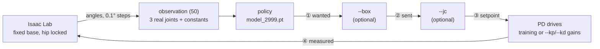

# Live walking policy on the right leg, in sim first (Isaac Lab)

How to run the walking policy in Isaac Lab on a **simulated copy of the right-leg gantry rig**, with
exactly the inputs from [`RIGHT_LEG_POLICY_LIVE.md`](RIGHT_LEG_POLICY_LIVE.md) section 2: 3 real
joints, and the other 47 inputs filled with the same constants. You see what the leg will do before
any motor moves, and you get the same log files as a real run, so the live guide's Part C analysis
works on both.

Status as of 2026-11-18, written from the code on `locomotion-policy` (076b4e41). **Nothing here has
run.** The script in step 2 is new. I've only checked that it parses as Python; it hasn't run in Isaac
Lab yet. The parts most likely to need a fix on first run are marked ⚠.

---

## 0. What this shows

The rig, and what each part of it becomes in sim:

| Real rig (live guide) | In sim (this guide) |
|---|---|
| Gantry holds the pelvis still | Robot base fixed in the air, 1.0 m up, so the foot hangs ~15 cm off the floor |
| Right thigh clamped vertical | Right hip pitch, roll and yaw locked at 0 (thigh vertical) |
| Left leg not driven | Left leg locked at the default pose. It doesn't affect the right leg: base fixed, no self-collision |
| Motors 59, 60, 61 | `Knee_R`, `Ankle_P_R`, `Ankle_R_R`, PD-driven like the training robot |
| Feedback: positions in 0.1° steps, no velocity | Sim angles rounded to 0.1°, velocity by differencing, then smoothed (same as `policy_deploy.py`) |
| Section 2 observation | Built the same way, slot for slot |
| Safety box + ease in/out | `--box`, `--ease` |
| `joint_command` (clamp, low-pass, 30 deg/s cap) | `--jc` |
| Real MIT gains | `--kp`, `--kd` |



The four signals ① to ④ are the same ones as in the live guide's section 1, with the same column
names in the same CSV files.

**What to expect.** Walking needs the floor, the hips, balance and the other leg. This rig has none of
those, so it **won't walk**. The best you'll see is the knee and ankle going through a stepping
motion in the air, at the gait clock's 1 s rhythm. You may also see nothing, a twitch, or a joint
pushed to one side. Every one of those is a useful answer: it's what the real leg will be asked to do.

---

## 1. Before you start

- [ ] The Isaac container runs and shows a window. On the host: `xhost +local:docker`, `./watod up -d`,
      then `./watod -t simulation_isaac` for a shell. Setup: `docker/simulation/isaac_lab/README.md`.
- [ ] Optional: the live guide's step **A1** has run. Note its printed `first action, vx 0`. Step 3
      compares against it.

### 1a. See the normal walk first

So you know what the policy does when it has everything it was trained with. In the container:

```bash
export PLAY_COMMAND=0.3,0,0
rl-play --task=Isaac-Locomotion-Flat-PioneerLegOnly-Play-v0 --num_envs 1 \
    --checkpoint models/pioneer_leg_only_flat/model_2999.pt
```

Use `export`. Writing `PLAY_COMMAND=... rl-play` on one line doesn't work: `rl-play` is an alias that
starts with `cd`, so the variable would go to `cd` and not to the play script.

Watch the **right knee and ankle** for a few strides: how far the knee bends in swing, how the ankle
lifts the toe. That's the motion the rig runs below are trying to show in the air. Close the window
when you're done.

---

## 2. Save the script

Save this as
`src/simulation/humanoid_rl_tasks/humanoid_rl_tasks/locomotion/config/pioneer/rig_policy_isaac.py`,
next to `sim2sim_mujoco.py`. The repo is mounted into the container, so the file shows up there too.

```python
"""The leg-only walking policy on a simulated right-leg gantry rig (Isaac Lab).

What explainers/RIGHT_LEG_POLICY_LIVE.md will run on the real leg, in sim: the pelvis is fixed in the air,
the right hip is clamped, and only the right knee and ankle are driven. The policy gets the observation of
that guide's section 2: real angles and velocities for --joints, constants for everything else.
Writes telemetry.csv and policy.csv in the live run's format, so its Part C analysis runs unchanged.

    $ISAACLAB/isaaclab.sh -p <this file> models/pioneer_leg_only_flat/model_2999.pt --vx 0
"""
import argparse
import csv
import math
import os
import time
from datetime import datetime

from isaaclab.app import AppLauncher

RIG = {"knee.pitch": "Knee_R", "ankle.pitch": "Ankle_P_R", "ankle.roll": "Ankle_R_R"}
MOTOR = {"knee.pitch": 59, "ankle.pitch": 60, "ankle.roll": 61}

p = argparse.ArgumentParser(description=__doc__.split("\n")[0])
p.add_argument("checkpoint")
p.add_argument("--joints", default="knee.pitch,ankle.pitch,ankle.roll", help="driven and fed to the policy; the rest are locked")
p.add_argument("--vx", type=float, default=0.0)
p.add_argument("--vy", type=float, default=0.0)
p.add_argument("--wz", type=float, default=0.0)
p.add_argument("--seconds", type=float, default=20.0, help="policy phase length; 2 s holds at default before and after")
p.add_argument("--box", type=float, default=0.0, help="deg around default, with ease in/out (as policy_deploy.py); 0 = no box")
p.add_argument("--ease", type=float, default=3.0, help="s, only with --box")
p.add_argument("--jc", action="store_true", help="add joint_command's clamp, low-pass and 30 deg/s cap after the box")
p.add_argument("--kp", type=float, nargs=3, metavar=("KNEE", "ANKLE_P", "ANKLE_R"), help="drive gains, N.m/rad (default: training's)")
p.add_argument("--kd", type=float, nargs=3, metavar=("KNEE", "ANKLE_P", "ANKLE_R"), help="N.m.s/rad")
p.add_argument("--label", default="")
AppLauncher.add_app_launcher_args(p)
args = p.parse_args()
joints = args.joints.split(",")
assert set(joints) <= set(RIG), f"--joints must be from {list(RIG)}"
app = AppLauncher(args).app

import numpy as np  # noqa: E402
import torch  # noqa: E402

import isaaclab.sim as sim_utils  # noqa: E402
from isaaclab.actuators import ImplicitActuatorCfg  # noqa: E402
from isaaclab.assets import AssetBaseCfg  # noqa: E402
from isaaclab.scene import InteractiveScene, InteractiveSceneCfg  # noqa: E402
from isaaclab.utils import configclass  # noqa: E402

from pioneer_humanoid.leg_only import LEG_ONLY_HUMANOID_CFG  # noqa: E402

REPO = os.path.abspath(os.path.join(os.path.dirname(__file__), *[".."] * 7))
JOINTS = ["Hip_F_L", "Hip_F_R", "Hip_A_L", "Hip_A_R", "Hip_R_L", "Hip_R_R", "Knee_L", "Knee_R", "Ankle_P_L", "Ankle_P_R", "Ankle_R_L", "Ankle_R_R"]
DEFAULT = np.array([{"Hip_F": 0.25, "Knee": -0.5, "Ankle_P": -0.25}.get(j[:-2], 0.0) for j in JOINTS])
KP = {"Knee_R": 200.0, "Ankle_P_R": 40.0, "Ankle_R_R": 40.0}  # training's (leg_only.py)
KD = {"Knee_R": 5.0, "Ankle_P_R": 2.0, "Ankle_R_R": 2.0}
EFFORT = {"Knee_R": 222.0, "Ankle_P_R": 60.0, "Ankle_R_R": 60.0}
HIP_PITCH = 0.0  # rad: the gantry clamps the thigh vertical. The policy is still told it is at default (0.25)
BASE_Z = 1.0  # m: hips 0.848 m above the soles with straight legs, so the foot hangs ~15 cm off the floor
DT, SUBSTEPS = 0.02, 4  # policy tick; physics at 5 ms, as in training
ALPHA, STEP = 0.85, 0.6  # leg_actuators.yaml global: low_pass_alpha; velocity_max 30 deg/s = 0.6 deg per tick

drive = [RIG[j] for j in joints]
d = [JOINTS.index(n) for n in drive]  # policy indices: 7, 9, 11
kp = dict(zip(RIG.values(), args.kp)) if args.kp else KP
kd = dict(zip(RIG.values(), args.kd)) if args.kd else KD
spawn = LEG_ONLY_HUMANOID_CFG.spawn
robot_cfg = LEG_ONLY_HUMANOID_CFG.replace(
    prim_path="{ENV_REGEX_NS}/Robot",
    # own USD folder: a fixed-base conversion must not overwrite the one training uses
    spawn=spawn.replace(fix_base=True, usd_dir=spawn.usd_dir + "_rig"),
    init_state=LEG_ONLY_HUMANOID_CFG.init_state.replace(
        pos=(0.0, 0.0, BASE_Z), joint_pos={**dict(zip(JOINTS, DEFAULT.tolist())), "Hip_F_R": HIP_PITCH}),
    actuators={
        "rig": ImplicitActuatorCfg(joint_names_expr=drive, stiffness={n: kp[n] for n in drive}, damping={n: kd[n] for n in drive},
                                   effort_limit_sim={n: EFFORT[n] for n in drive}, armature=0.01),
        # everything else held where it is, like the clamp (hip) or a joint that isn't in this run
        "locked": ImplicitActuatorCfg(joint_names_expr=[n for n in JOINTS if n not in drive], stiffness=1.0e4, damping=1.0e2,
                                      effort_limit_sim=1.0e4, armature=0.01),
    },
)


@configclass
class RigSceneCfg(InteractiveSceneCfg):
    ground = AssetBaseCfg(prim_path="/World/ground", spawn=sim_utils.GroundPlaneCfg())
    light = AssetBaseCfg(prim_path="/World/light", spawn=sim_utils.DomeLightCfg(intensity=1000.0, color=(0.75, 0.75, 0.78)))
    robot = robot_cfg


def load_actor(path: str) -> torch.nn.Module:
    """sim2sim_mujoco.py's: the actor MLP (ELU, no observation normalisation) of an rsl_rl checkpoint."""
    state = torch.load(path, map_location="cpu")["model_state_dict"]
    weights = sorted((k for k in state if k.startswith("actor.") and k.endswith(".weight")), key=lambda k: int(k.split(".")[1]))
    layers = []
    for i, k in enumerate(weights):
        linear = torch.nn.Linear(*reversed(state[k].shape))
        linear.weight.data, linear.bias.data = state[k], state[k.replace("weight", "bias")]
        layers += [linear] + ([torch.nn.ELU()] if i < len(weights) - 1 else [])
    return torch.nn.Sequential(*layers).eval()


def main() -> None:
    sim = sim_utils.SimulationContext(sim_utils.SimulationCfg(dt=DT / SUBSTEPS, render_interval=SUBSTEPS, device=args.device))
    sim.set_camera_view((0.5, -1.8, 0.8), (0.0, -0.15, 0.5))  # from the robot's right, at knee height
    scene = InteractiveScene(RigSceneCfg(num_envs=1, env_spacing=2.0))
    sim.reset()
    robot = scene["robot"]
    ids = robot.find_joints(JOINTS, preserve_order=True)[0]  # sim index of each JOINTS entry
    sim_d = [ids[i] for i in d]
    robot.write_joint_state_to_sim(robot.data.default_joint_pos.clone(), robot.data.default_joint_vel.clone())
    robot.reset()
    lo, hi = np.degrees(robot.data.joint_pos_limits[0, sim_d].cpu().numpy()).T
    actor = load_actor(args.checkpoint)

    run = os.path.join(REPO, "outputs", "policy_sim", datetime.now().strftime("%Y%m%d-%H%M%S") + (f"_{args.label}" if args.label else ""))
    os.makedirs(run)
    tel_file = open(os.path.join(run, "telemetry.csv"), "w", newline="")
    pol_file = open(os.path.join(run, "policy.csv"), "w", newline="")
    tel = csv.writer(tel_file)
    tel.writerow(["t_s", "source", "motor_id", "joint", "phase", "sp_deg", "sp_raw_deg", "pos_deg", "tau_nm", "kp"])
    pol = csv.writer(pol_file)
    pol.writerow(["t_s", "dt_ms"] + [f"obs_{i}" for i in range(50)] + [f"act_{i}" for i in range(12)]
                 + [f"wanted_{n}" for n in drive] + [f"sent_{n}" for n in drive])

    default_deg = np.degrees(DEFAULT[d])
    cmd = np.array([args.vx, args.vy, args.wz])
    hold = int(2.0 / DT)
    phases = ["hold"] * hold + ["policy"] * int(args.seconds / DT) + ["hold"] * hold
    targets = robot.data.default_joint_pos.clone()  # locked joints stay at their start angle
    action, qd, q_prev, sp = np.zeros(12), np.zeros(len(d)), None, None
    for k, phase in enumerate(phases):
        if not app.is_running():
            break
        wall = time.time()
        # what the drives report: command-frame degrees in 0.1 deg steps, no velocity
        meas = np.round(np.degrees(robot.data.joint_pos[0, sim_d].cpu().numpy()) * 10.0) / 10.0
        q = np.radians(meas) - DEFAULT[d]
        if q_prev is not None:
            qd = 0.5 * qd + 0.5 * (q - q_prev) / DT
        q_prev = q
        if phase == "policy":
            t = (k - hold) * DT  # gait clock starts with the policy
            q_rel, qd_rel = np.zeros(12), np.zeros(12)
            q_rel[d], qd_rel[d] = q, qd
            obs = np.concatenate([[0, 0, 0, 0, 0, 0, 0, 0, -1.0], cmd, q_rel, qd_rel, action,
                                  [math.sin(2 * math.pi * (t % 1.0)), math.cos(2 * math.pi * (t % 1.0))]])
            with torch.no_grad():
                action = actor(torch.from_numpy(obs.astype(np.float32))[None]).numpy()[0].astype(float)
            if k == hold:
                print("first action:", action.round(3))
            wanted = np.degrees(DEFAULT + 0.25 * action)[d]
            sent = wanted
            if args.box:
                x = min(t / args.ease, (args.seconds - t) / args.ease, 1.0)
                sent = default_deg + (0.5 - 0.5 * math.cos(math.pi * max(x, 0.0))) * np.clip(wanted - default_deg, -args.box, args.box)
            pol.writerow([f"{k * DT:.4f}", f"{DT * 1000:.1f}"] + [f"{v:.5f}" for v in np.concatenate([obs, action, wanted, sent])])
        else:
            sent = default_deg
        if args.jc:  # joint_command_core.cpp: clamp, low-pass, then the per-tick step cap
            target = np.clip(sent, lo, hi)
            if sp is not None:
                target = ALPHA * sp + (1.0 - ALPHA) * target
                target = sp + np.clip(target - sp, -STEP, STEP)
            sp = target
        else:
            sp = sent
        targets[0, sim_d] = torch.tensor(np.radians(sp), dtype=targets.dtype, device=targets.device)
        robot.set_joint_position_target(targets)
        for _ in range(SUBSTEPS):
            scene.write_data_to_sim()
            sim.step(render=False)
            scene.update(DT / SUBSTEPS)
        sim.render()
        pos = np.degrees(robot.data.joint_pos[0, sim_d].cpu().numpy())
        tau = robot.data.applied_torque[0, sim_d].cpu().numpy()
        for i, j in enumerate(joints):
            tel.writerow([f"{k * DT:.4f}", "sim", MOTOR[j], j, phase, f"{sp[i]:.4f}", f"{sent[i]:.4f}", f"{pos[i]:.4f}",
                          f"{tau[i]:.5f}", f"{kp[drive[i]]:.4f}"])
        if not args.headless:
            time.sleep(max(0.0, DT - (time.time() - wall)))  # real time, so you can watch it
    tel_file.close()  # before app.close(), which may exit without flushing
    pol_file.close()
    print(f"run folder: {run}")


if __name__ == "__main__":
    main()
    app.close()
```

### Where section 2 lives in the script

| Section 2 row | In the script |
|---|---|
| base velocities = 0, gravity = (0, 0, −1) | `obs = np.concatenate([[0, 0, 0, 0, 0, 0, 0, 0, -1.0], ...` |
| command vx, vy, wz | `cmd`, from `--vx --vy --wz` |
| joint angle − default: real for `--joints`, 0 for the rest | `q_rel[d] = q` (the rest stay 0) |
| joint velocity: differenced and smoothed | `qd = 0.5 * qd + 0.5 * (q - q_prev) / DT` |
| last action: the network's own raw output | `action` from the previous tick |
| gait clock, t from policy start | `t = (k - hold) * DT` |
| target = default + 0.25 × action, keep 7, 9, 11 | `wanted = np.degrees(DEFAULT + 0.25 * action)[d]` |

### The run, tick by tick

1. **Hold, 2 s.** The rig joints are held at the default pose. The policy isn't running yet. Gravity
   pulls the shank a little off default (see 3b).
2. **Policy, `--seconds`.** Every 20 ms: read the 3 joints, build the observation, run the network,
   then box, then `joint_command`, then the drives. The physics takes four 5 ms steps per tick, like training.
3. **Hold, 2 s** at default, then the script exits and prints the run folder.

The run plays in real time, so you can watch it. With `--headless` there's no window and it runs as
fast as it can; you still get the CSVs.

### Two choices the script makes that differ from the real rig

- **Hip pitch is locked at 0 (thigh vertical), but the policy is told it's at its default of 0.25 rad
  (14°).** That matches section 2 (other joints read as "at default") and the clamp. It also means the
  shank hangs 14° further back than the policy thinks. Change `HIP_PITCH` to 0.25 to see whether that matters.
- **A rig joint left out of `--joints` is locked at default.** On the real leg an inactive motor isn't
  commanded at all, so it probably hangs loose instead. Keep that in mind for the single-joint stages.

---

## 3. First run: the policy alone, nothing in the way

**Question:** with these inputs, what does the policy make the knee and ankle do, when nothing (box,
`joint_command`, weak gains) limits it?

### 3a. Run it

In the container:

```bash
cd $HUMANOID_ROOT
$ISAACLAB/isaaclab.sh -p src/simulation/humanoid_rl_tasks/humanoid_rl_tasks/locomotion/config/pioneer/rig_policy_isaac.py \
    models/pioneer_leg_only_flat/model_2999.pt --vx 0 --label r1
```

The first run converts the robot to a fixed-base USD in `outputs/rl/assets/pioneer_leg_only_humanoid/usd_rig`.
That takes a minute; later runs reuse it.

⚠ If it fails before the window opens, the likely causes are the fixed-base conversion
(`fix_base=True` with `root_link_name="base"`) or an Isaac Lab name (`joint_pos_limits`,
`applied_torque`). Paste the traceback to me or check the Isaac Lab 2.3.2 API.

### 3b. What to look at

- **During the hold:** the shank should hang at the default bend (knee −28.65°, ankle pitch −14.3°),
  sagging about 2° under gravity. A shank that hangs straight means the gains aren't applied.
- **The printed `first action`:** it should be close to the live guide's A1 `first action, vx 0`. It
  won't be identical: the 2° sag means the policy's first input isn't exactly "at default". If it's
  far off, the observation is built differently from training.
- **During the policy phase:** the knee and the ankle pitch. Do they move in a 1 s rhythm? How far?
  Does a joint go to a limit and stay there?

### 3c. Numbers

On the host, from the repo root, using the run folder the script printed (`outputs/policy_sim/<stamp>_r1`):

```bash
python3 - outputs/policy_sim/<stamp>_r1 <<'EOF'
import csv, sys
rows = [r for r in csv.DictReader(open(f"{sys.argv[1]}/telemetry.csv")) if r["phase"] == "policy"]
for j in sorted({r["joint"] for r in rows}):
    pos = [float(r["pos_deg"]) for r in rows if r["joint"] == j]
    tau = [abs(float(r["tau_nm"])) for r in rows if r["joint"] == j]
    print(f"{j:12s} range {min(pos):7.1f} .. {max(pos):7.1f} deg   peak |torque| {max(tau):6.1f} N.m")
EOF
```

| Run | Joint | Range (deg) | Peak \|torque\| (N·m) | Rhythm? (≈1 s / none / stuck at a limit) | Notes |
|---|---|---|---|---|---|
| r1 | knee.pitch | | | | |
| r1 | ankle.pitch | | | | |
| r1 | ankle.roll | | | | |

Compare peak torque with the real limit: today's knee `mit_max_torque` is 30 N·m (the left knee, in
`leg_actuators.yaml`; the right has none yet). Above that, the real drive faults.

---

## 4. Add the real rig's limits, one at a time

Each run changes one thing from the run before it, so you can tell what changed the motion. Same
command as 3a, with these flags:

| Run | Flags | Adds | Matches live run |
|---|---|---|---|
| r1 | `--vx 0` | (done in step 3) | |
| r2 | `--vx 0.3` | a walking command | |
| r3 | `--vx 0 --box 5 --jc` | safety box and `joint_command` | stage 5, row a |
| r4 | `--vx 0 --box 10 --jc --seconds 30` | | stage 5, row b |
| r5 | `--vx 0.3 --box 10 --jc --seconds 30` | | stage 5, row c |
| r6 | `--vx 0.3 --box 20 --jc --seconds 60` | | stage 5, row d |
| r7 | r6 + `--kp 10 40 40 --kd 3.4 2 2` | the real knee's gains | stage 5, row d, real gains |

Give each run its `--label` (`r2`, `r3`, ...).

**r7's gains:** kp 10 and kd 3.4 are the **left** knee's current values (the last `mit_kp`/`mit_kd` in
its block of `leg_actuators.yaml`). The right leg has no gains yet, and the ankle numbers are still
training's 40 and 2. When the replay guide's B5 sets the right leg's gains, rerun r7 with those. At kp
10 expect the knee to sag ~17° straighter than its target (shank ≈ 6 kg at 0.25 m; sag = torque ÷ kp).
That's the "knee gains strong enough" gate from the replay guide, made visible.

**Single-joint stages** (live stages 1–4): add `--joints ankle.pitch`, `--joints ankle.roll`,
`--joints ankle.pitch,ankle.roll` or `--joints knee.pitch`. The rig joints left out are locked at default.

**What to watch for**, in the window:

| You see | Means |
|---|---|
| r2 moves more, or differently, from r1 | the command reaches the policy; it's trying to step |
| r3: smaller and smoother than r1 | the box and the 30 deg/s cap doing their job |
| The joint swings edge to edge of the box at a steady rate | closed-loop ringing: the policy reacting to its own joint through `joint_command`'s lag. The live guide's "stop at once" case. Note the frequency. |
| r7: knee hangs well straighter than the others | gravity sag at kp 10 |

---

## 5. Did the "motors" follow? Same analysis as the real leg

The script writes `telemetry.csv` and `policy.csv` with the columns the live guide's **Part C**
analysis reads (`t_s`, `phase`, `joint`, `sp_raw_deg`, `sp_deg`, `pos_deg`; `t_s`, `dt_ms`,
`wanted_<URDF name>`). Run that analysis unchanged on each sim run folder, on the host:

```bash
uv run --with matplotlib --with numpy python - outputs/policy_sim/<stamp>_r3 <<'EOF'
# paste the Part C script from RIGHT_LEG_POLICY_LIVE.md section 5 here, unchanged
EOF
```

It prints the box gap, `joint_command` gap, motor gap and lag per joint, and saves `follow.png`. Skip
`gl40_telemetry_plot.py`: it expects columns the sim doesn't write.

In sim, `dt_ms` is always exactly 20, and without `--jc` the `joint_command` gap is 0 by construction.

| Run | Joint | box gap rms/max | jc gap rms/max | motor gap rms/max | lag ms | boxed % |
|---|---|---|---|---|---|---|
| | | | | | | |

### Reading it

| You see | Means | For the real run |
|---|---|---|
| Motor gap ≲ 1° at training gains | the sim drive is stiff: what's sent is what happens | the real motor gap will be bigger; this is the floor |
| Motor gap at r7 ≫ r6 | the real gains can't follow this motion | expect the same on the leg, or worse |
| Boxed % near 100 at every box size | the policy always pushes past the box | expected with these inputs; the live guide says the same |
| `joint_command` gap big, setpoint climbing at exactly 0.6°/tick | the policy wants faster moves than 30 deg/s | expected; don't raise the cap for this |
| Same ringing frequency in sim and later on the leg | the loop, not the motor, is the cause | keep the box small |

Keep these sim results. When the real run happens, put the two tables side by side: **sim
prediction vs real leg**, per run.

---

## 6. What the sim leaves out

These all make the real leg do worse than the sim, so read the sim as the best case:

- **Delays.** In sim, the target reaches the drive in the same tick. On the real leg there's ROS,
  `joint_command`'s own 50 Hz tick, CAN and the drive: likely one or more ticks more. Extra delay makes
  ringing more likely.
- **The drive.** The sim drive is a perfect spring and damper. The real one has friction, cogging,
  backlash and a torque limit that faults (`mit_max_torque`) instead of saturating.
- **The ankle linkage.** In sim, ankle pitch and roll are two independent joints. On the real leg
  they're driven through a linkage (replay guide, D1). Whether one motor really moves only one axis is
  still an open question.
- **Joint limits.** `--jc` clamps to the URDF limits. The real `joint_command` clamps to the
  calibrated limits in `leg_calibration.yaml`, which are narrower.
- **Inactive joints** hang loose on the real leg; here they're locked (section 2).

---

## Glossary

| Term | Plain meaning |
|---|---|
| Policy | The trained network. Every 20 ms it reads 50 numbers and outputs 12. |
| Observation | Those 50 inputs. Section 2 of the live guide lists them. |
| Fixed base | The robot's pelvis is bolted to the world in sim, like the gantry. |
| Locked joint | Held by a very stiff spring (kp 10 000) at one angle: the sim's version of a clamp. |
| Box | The live guide's safety limit: the sent target stays within ±box° of the default pose. |
| `--jc` | The sim copy of `joint_command`: clamp to limits, low-pass (alpha 0.85, ~0.13 s), at most 0.6° per tick. |
| kp, kd | Drive spring (N·m per rad) and damper (N·m·s per rad). Training used 200/5 (knee) and 40/2 (ankles). |
| Sag | How far gravity pulls a joint off its target: torque ÷ kp (rad; × 57.3 for degrees). |
| Gait clock | The policy's sense of time: a 1 s cycle. Each leg stands for 55% of its own cycle; the right leg's is half a cycle behind the left's, so it's meant to swing from about 0.05 s to 0.5 s of each second (`gait.py`). |

Conversions: 1 rad = 57.3°. 30 deg/s at 50 Hz = 0.6° per tick. 0.25 × action 1.0 = 0.25 rad = 14.3° off default.
