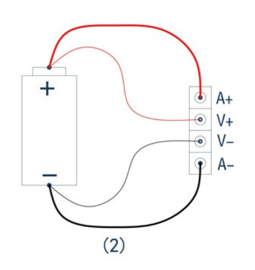

# DL24 BATTERY DRAINER INSTRUCTIONS

The official manual is found [here](http://en.atorch.cn/upload/20241224153104.pdf).

1. Connect 12VDC barrel connector to drainer. Drainer should power on, and show voltage, current, and power at 0V

2. ❗Ensure the battery is switched OFF to avoid short circuit. Wire the battery to the drainer as 
illustrated in the diagram below.

3. Close switch. Drainer should now show battery powered.

4. Long hold the 'SET' button. Ensure drainer is in CC mode, and cutoff voltage is set to 51.0V

5. Press start. Drainer will start discharging, and automatically stop when finished. Final voltage should be roughly around 51.4-51.5V

