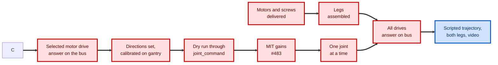
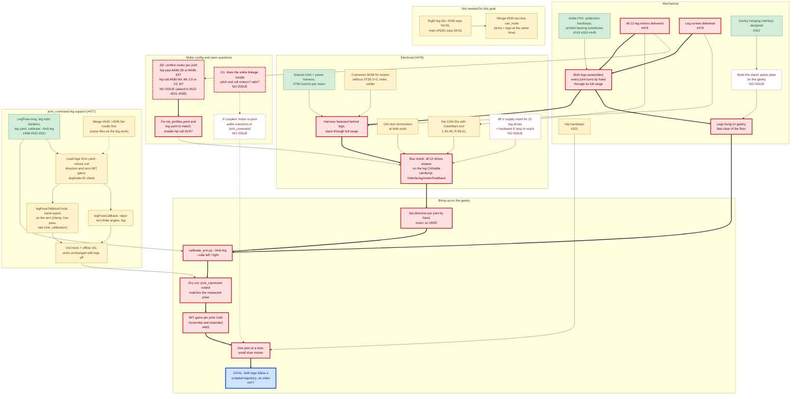

# Leg bring-up plan: assembled legs moving on the gantry

Goal: both legs fully assembled, hung on the gantry (no torso), and every joint following a scripted
trajectory sent on `/leg/<side>/joint_targets` through `joint_command`. Walking, IMU and RL are out
of scope (listed at the end).

Status as of 2026-11-16, from `main` (1133f33a) and the GitHub issues and PRs. Hardware status comes
from issue comments, the newest from 2026-11-05. **Check the hardware boxes against the real legs
before using this.**

## Critical path at a glance

The long pole is hardware. Software (#477) can start today and finishes before the motors and screws
arrive if it is started now. Two unknowns could each add their own long step: the **motor-model
question** (D0) and the **ankle linkage** (D1). Answer both this week.

## Full dependency graph

**Legend:** thick arrows and red nodes = critical path. Dashed red = unknowns that could join the
critical path. Green = done. Yellow = open, not critical. Dashed white = needed but has no issue yet.

## Steps and where they stand

| Node | Step | Tracked in | Assignee | Status / blocker |
|---|---|---|---|---|
| M1, M2 | Leg motors and screws delivered | #478 (comment 2026-11-04) | none | Not all motors had arrived; screws pending. #477 (2026-11-04) says "the leg is built". Confirm which is true now. |
| M3 | Both legs assembled | none | none | Waits on M1, M2. |
| M4 | Hip hardstops | #321 | junomu25 | Open. Needed before full-range hip moves (B5), not before small moves. |
| M5 | Build the gantry stand / pelvis plate | none (#322 closed, design only) | none | **No issue for the build.** Without a torso, the hips need something to bolt to. |
| E1, E3, E4, E5 | Connectors, CAN IDs, termination, routing | #478 (due 2026-11-07, overdue) | none | Harness branches done. IDs wait on M1. Routing waits on M3 and screws. |
| E6 | 48 V supply and E-stop for the legs | none | none | **No issue.** The bus bar work (#471, #475) only covers the 10 arm motors. |
| D0, S0 | Confirm motor models; fix `mit_profiles.yaml` | questions in #522, #531, #538 | none | Hip roll 41/57 is commented out, so can_node won't drive it. Hip yaw model is unknown, and a wrong one makes the MIT scaling wrong. |
| D1, S8 | Ankle linkage coupling | none (#538 uses a placeholder ratio of 1.5) | none | If the two ankle motors move pitch and roll together, `joint_command` needs a transform before the ankles can move. |
| S1 | Leg msg, topic skeleton, yaml, calibration script | #498, #522, #531 | merged | Done 2026-11-14. |
| S4-S7 | Leg path in `joint_command` | #477 (TODOs in `joint_command_node.cpp` and `joint_command_core.cpp`) | juliejyyang, AydanLing, reneeyyx, anitajiang8 | Not started. `legPoseToMotorCmds` returns no commands and `legs:` throws at startup. Can start today. |
| X3 | Fail-loudly PRs | #543, #545 | none | Open. They edit the same loader and core code that S4/S5 change. Merge them first or expect conflicts. |
| B1-B3 | Directions, calibration, dry run | #477 | | Waits on E9, M6, S7. |
| B4 | MIT gains for legs | #483 (due 2026-11-13, overdue) | none | Depends on #480 (closed, merged into #477) and #482. |
| B5, G | Single-joint moves, then scripted video | #477 | | Final step. |
| X1, X2 | Two-bus can_node | #530 (approved, open); #482 closed though #530 is not merged | sardormirk | **Not on the critical path.** For legs-only bring-up, point the single-bus `can_node` (`params.yaml` `device_path`) at the leg CANable. Before #530 merges, fix its right-leg IDs (50-55) to match `main` (56-61). |

## Decisions to make now

1. **Motor inventory (D0).** Record the actual model and firmware of every leg motor, then fix
   `mit_profiles.yaml` and `leg_actuators.yaml` to match. File an issue for this.
2. **Ankle linkage (D1).** Ask mechanical whether ankle pitch and roll each have their own motor
   or are coupled through the linkage, and what the ratio is. If coupled, file an issue for the
   `joint_command` transform. It may then take longer than the rest of the software.
3. **One bus or two for the legs.** At `joint_command`'s 50 Hz, 12 drives on one 1 Mbit/s bus use
   about 16 % of it, so one shared leg bus (#477, #478) is fine for this goal. The 250 Hz walking
   loop (#196) needs one bus per leg (#197 comment). Revisit then.
4. **File the missing issues:** gantry stand build (M5), leg power and E-stop (E6), motor
   inventory (D0), ankle transform (S8, if needed).

## Safety gates (from `.claude/skills/real-hardware-safety`)

These are already in the graph; they are the steps not to skip:

- Every move goes through `joint_command`. Never publish `MotorCmd` directly.
- Hardware E-stop on the 48 V supply within reach for every powered test (E6).
- Calibrate hanging (M6 before B2). Do a read-only dry run before the first live command (B3).
- One joint at a time with the others `active: false`, small slow moves from the measured pose
  (B5). Raise `velocity_max` (30 deg/s) or gains only with bench data.

## After this goal: walking (not in the graph)

IMU on CAN (#195), 250 Hz leg loop (#196), actuator models and sysid (#335, #538), retraining on
the new leg (#153), sim2sim check (#293), CAN telemetry dashboard (#214), CAN-FD (#189, #193).
