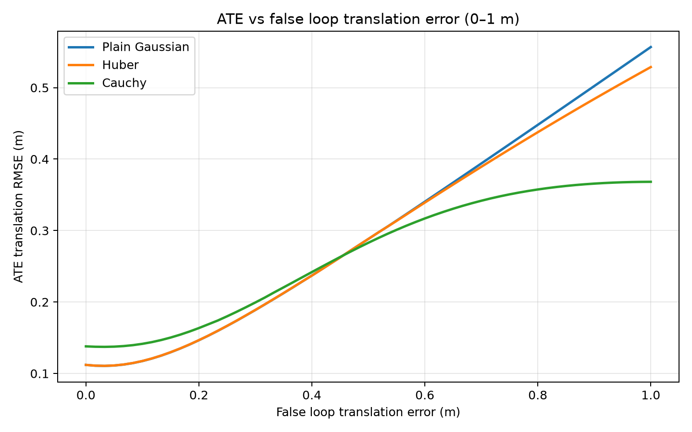
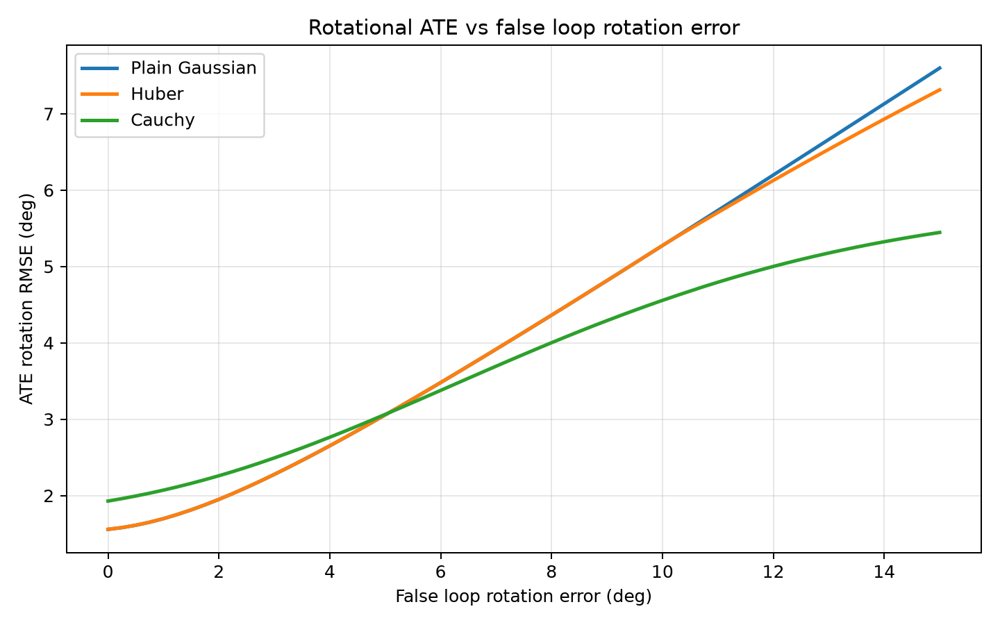

# BE-5 loop-robustness results

These are deterministic synthetic tests of the pose-graph backend, not results
from a recorded robot run. The path has 37 poses over a closed 3D route. VO is
given a small fixed error on every relative motion, so its accumulated estimate
drifts away from the known path.

The backend runs iSAM2 with `relinearizeSkip = 1` and 20 extra updates after each
loop closure, and the plain Gaussian reference uses the same settings, so all
three cases are converged (the results stop changing as updates are added).

## What the unittest checks

`test_pose_graph_loops.py` uses Python's built-in `unittest` framework. Each
method named `test_*` runs a scenario and asserts expected behavior. A failed
assertion makes the command report a failure and exit nonzero; `OK` means all
checks passed. The three tests check that a correct loop lowers translation and
rotation ATE, and that Huber and Cauchy reduce false-loop damage compared with a
plain Gaussian loop factor.

Run inside the Humble container with GTSAM installed:

```bash
source /root/backend-venv/bin/activate
PYTHONPATH=/work/pioneer_humanoid/src/perception/slam/slam_core \
  python /work/pioneer_humanoid/src/perception/slam/slam_core/tests/test_pose_graph_loops.py
```

All three tests passed.

## VO-only versus a correct loop

ATE is RMSE over all poses. Endpoint errors compare the estimated final pose
with the starting pose; the synthetic ground-truth path returns to its start.

| Case | Translation ATE (m) | Rotation ATE (deg) | Endpoint translation (m) | Endpoint rotation (deg) |
|---|---:|---:|---:|---:|
| VO only | 0.2501 | 4.83 | 0.3967 | 8.23 |
| Correct loop, Huber | 0.1120 | 1.56 | 0.0087 | 0.65 |
| Correct loop, Cauchy | 0.1379 | 1.93 | 0.0457 | 2.62 |

Both kernels improved the trajectory with a correct loop in this setup. Huber
gave the lower ATE in this particular case.

## Large false loop used by the unit tests

The fixed combined outlier has a translation error of `[8, -6, 9] m`, magnitude
**13.4536 m**, plus rotation offsets with roll/pitch/yaw of `0.7, -0.4, 0.9 rad`.

| Loop factor | Translation ATE (m) | Rotation ATE (deg) | Endpoint translation (m) | Endpoint rotation (deg) |
|---|---:|---:|---:|---:|
| Plain Gaussian | 7.4012 | 62.66 | 13.1594 | 78.05 |
| Huber | 2.0704 | 34.88 | 4.3345 | 52.32 |
| Cauchy | 0.2586 | 4.99 | 0.4211 | 8.45 |

Huber reduced the damage versus plain Gaussian, but still distorted the path
substantially. Cauchy stayed close to the VO-only result, so it is the backend's
default loop kernel. Robust kernels limit an outlier's influence; they do not
verify or automatically reject a loop.

## Translation-error sweep: 0 to 1 m

This sweep changes only the false loop's translation offset, from 0 to 1 m;
the loop rotation stays correct. At 0 m the loop measurement is correct. The
plot shows translation ATE against false-loop translation error:



| False translation error (m) | Plain Gaussian ATE (m) | Huber ATE (m) | Cauchy ATE (m) |
|---:|---:|---:|---:|
| 0.00 | 0.1120 | 0.1120 | 0.1379 |
| 0.25 | 0.1666 | 0.1667 | 0.1800 |
| 0.50 | 0.2882 | 0.2883 | 0.2829 |
| 0.75 | 0.4209 | 0.4137 | 0.3507 |
| 1.00 | 0.5568 | 0.5288 | 0.3682 |

## Angular-error sweep: 0 to 15 degrees

This sweep keeps the loop translation correct and adds a pure yaw error from 0°
to 15°. The plot shows rotational ATE against false-loop rotation error:



| False rotation error (deg) | Plain Gaussian ATE (deg) | Huber ATE (deg) | Cauchy ATE (deg) |
|---:|---:|---:|---:|
| 0 | 1.5570 | 1.5582 | 1.9278 |
| 2.5 | 2.1060 | 2.1067 | 2.3705 |
| 5.0 | 3.0561 | 3.0566 | 3.0632 |
| 7.5 | 4.1385 | 4.1390 | 3.8496 |
| 10.0 | 5.2738 | 5.2751 | 4.5561 |
| 12.5 | 6.4307 | 6.3320 | 5.0923 |
| 15.0 | 7.5987 | 7.3130 | 5.4458 |

## Real data: TUM fr3 long_office_household

The sections above are synthetic. This one runs the backend on a real sequence with
ground truth: TUM RGB-D `freiburg3_long_office_household` (87 s, 21.5 m, the end of the
trajectory overlaps the beginning). The VO is the prototype in `prototype/vo.py`
(XFeat + LighterGlue, PnP with depth), fed the TUM frames by a small runner script that
is not in the repo. 2488 of 2585 frames had a depth frame within 20 ms and were used.
VO produced 150 keyframes, lost tracking 0 times, and found 3 loops with its own
brute-force detector (49, 125 and 123 PnP inliers).

ATE is the RMSE of position error against ground truth after a rigid alignment
(no scale), over 2486 matched poses.

| Trajectory | Translation ATE (m) | Max error (m) | Rotation ATE (deg) |
|---|---:|---:|---:|
| VO only | 0.1051 | 0.2415 | 2.73 |
| Backend, no loops | 0.1051 | 0.2415 | 2.73 |
| Backend, 3 loops, Huber | 0.0356 | 0.0903 | 1.58 |
| Backend, 3 loops, Cauchy | 0.0357 | 0.0895 | 1.58 |

The three detected loops cut the translation ATE by about 66%. With these loops the two
kernels are indistinguishable, since none of the loops is wrong.

### One false loop added to the real loops

To test the kernels on real data, one wrong loop was added on top of the 3 real loops.
It uses a real revisit pair (KF 9 to KF 143, 78 s apart and 0.13 m apart in position)
with the measured relative pose corrupted by the translation error below. Scores are
keyframe-level translation ATE (m); without the false loop it is 0.0350 m. The "plain
loop factor" is Huber with a huge scale, so effectively a quadratic factor.

| False loop error | Plain loop factor | Huber | Cauchy |
|---|---:|---:|---:|
| 0 m (correct) | 0.0347 | 0.0348 | 0.0350 |
| 0.5 m | 0.0699 | 0.0399 | 0.0353 |
| 1.0 m | 0.1254 | 0.0409 | 0.0351 |
| 2.0 m | 0.2423 | 0.0415 | 0.0350 |
| 4.0 m | 0.4794 | 0.0418 | 0.0350 |
| 1.0 m + 30 deg | 0.1403 | 0.0413 | 0.0352 |

The plain loop factor gets worse as the false loop error grows (worse than VO alone from
about 1 m). Huber caps the damage at about 0.04 m. Cauchy stays within 0.0003 m of the
no-false-loop result at every error size, and costs nothing when the loop is correct.

Limits: one sequence, one false loop and one pair, with a fixed error direction. The false
loop is a real revisit with a corrupted pose, which is cleaner than real perceptual
aliasing, and several consistent false loops would be harder. The detected loops were
not checked against ground truth, and ATE was computed with a small script that
mirrors `evo_ape --align` (nearest-timestamp match, rigid alignment), not with `evo`.

## Rerun the tests and graphs

```bash
source /root/backend-venv/bin/activate
export PYTHONPATH=/work/pioneer_humanoid/src/perception/slam/slam_core:/work/pioneer_humanoid/src/perception/slam/slam_core/tests
python /work/pioneer_humanoid/src/perception/slam/slam_core/tests/test_pose_graph_loops.py
python /work/pioneer_humanoid/src/perception/slam/slam_tools/backend/evaluate_loop_robustness.py
```

The sweep script defaults to 0–1 m translation error and 0–15° rotation error
with 61 samples. Use `--max-error`, `--max-rotation-deg`, `--points`, or
`--output-dir` to change the ranges, resolution, or plot location. The separate
fixed gross-outlier unit test still uses a 13.4536 m translation error; it is
not part of these bounded sweeps.
