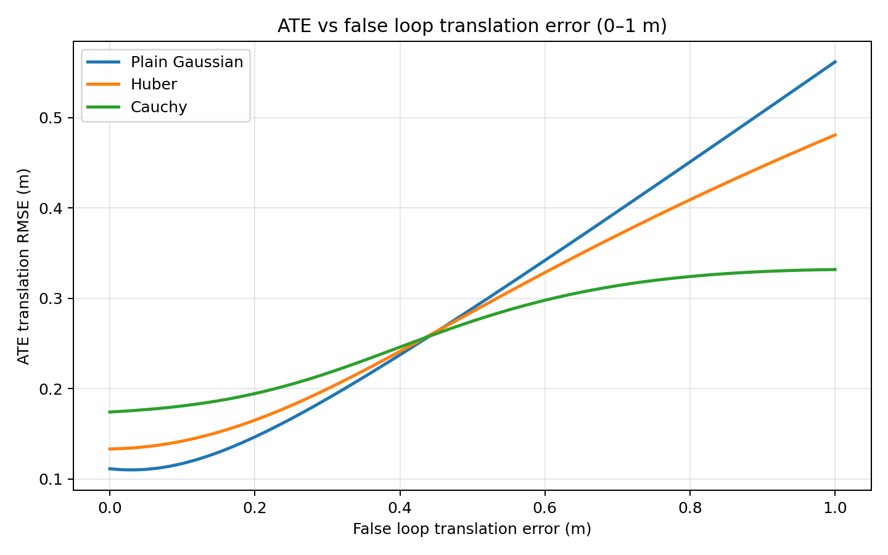
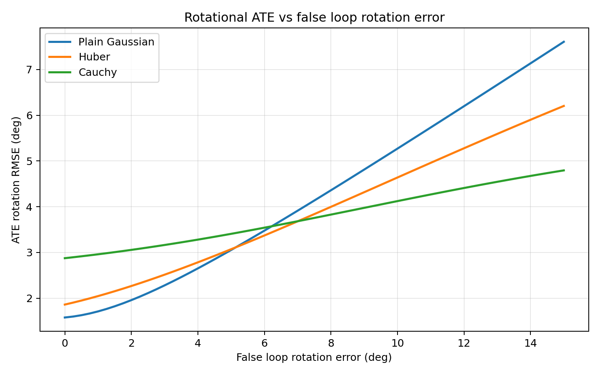

# BE-5 loop-robustness results

These are deterministic synthetic tests of the pose-graph backend, not results
from a recorded robot run. The path has 37 poses over a closed 3D route. VO is
given a small fixed error on every relative motion, so its accumulated estimate
drifts away from the known path.

## What the unittest checks

`test_pose_graph_loops.py` uses Python's built-in `unittest` framework. Each
method named `test_*` runs a scenario and asserts expected behavior. A failed
assertion makes the command report a failure and exit nonzero; `OK` means all
checks passed. The three tests check that a correct loop lowers translation and
rotation ATE, and that Huber and Cauchy reduce false-loop damage compared with a
plain Gaussian loop factor.

Run inside the Humble container with GTSAM installed:

```bash
source /root/backend-venv/bin/activate
PYTHONPATH=/work/pioneer_humanoid/src/perception/slam/slam_core \
  python /work/pioneer_humanoid/src/perception/slam/slam_core/tests/test_pose_graph_loops.py
```

All three tests passed.

## VO-only versus a correct loop

ATE is RMSE over all poses. Endpoint errors compare the estimated final pose
with the starting pose; the synthetic ground-truth path returns to its start.

| Case | Translation ATE (m) | Rotation ATE (deg) | Endpoint translation (m) | Endpoint rotation (deg) |
|---|---:|---:|---:|---:|
| VO only | 0.2501 | 4.83 | 0.3967 | 8.23 |
| Correct loop, Huber | 0.1333 | 1.86 | 0.0393 | 2.37 |
| Correct loop, Cauchy | 0.1742 | 2.88 | 0.1436 | 4.90 |

Both kernels improved the trajectory with a correct loop in this setup. Huber
gave the lower ATE in this particular case.

## Large false loop used by the unit tests

The fixed combined outlier has a translation error of `[8, -6, 9] m`, magnitude
**13.4536 m**, plus rotation offsets with roll/pitch/yaw of `0.7, -0.4, 0.9 rad`.

| Loop factor | Translation ATE (m) | Rotation ATE (deg) | Endpoint translation (m) | Endpoint rotation (deg) |
|---|---:|---:|---:|---:|
| Plain Gaussian | 7.1217 | 64.95 | 12.9132 | 74.79 |
| Huber | 1.6284 | 28.78 | 3.3459 | 43.16 |
| Cauchy | 0.2591 | 4.95 | 0.4203 | 8.40 |

Huber reduced the damage versus plain Gaussian, but still distorted the path
substantially. Cauchy stayed close to the VO-only result. Robust kernels limit
an outlier's influence; they do not verify or automatically reject a loop.

## Translation-error sweep: 0 to 1 m

This sweep changes only the false loop's translation offset, from 0 to 1 m;
the loop rotation stays correct. At 0 m the loop measurement is correct. The
plot shows translation ATE against false-loop translation error:



| False translation error (m) | Plain Gaussian ATE (m) | Huber ATE (m) | Cauchy ATE (m) |
|---:|---:|---:|---:|
| 0.00 | 0.1113 | 0.1333 | 0.1742 |
| 0.25 | 0.1667 | 0.1813 | 0.2048 |
| 0.50 | 0.2890 | 0.2853 | 0.2748 |
| 0.75 | 0.4237 | 0.3899 | 0.3199 |
| 1.00 | 0.5619 | 0.4810 | 0.3319 |

## Angular-error sweep: 0 to 15 degrees

This sweep keeps the loop translation correct and adds a pure yaw error from 0°
to 15°. The plot shows rotational ATE against false-loop rotation error:



| False rotation error (deg) | Plain Gaussian ATE (deg) | Huber ATE (deg) | Cauchy ATE (deg) |
|---:|---:|---:|---:|
| 0 | 1.5788 | 1.8617 | 2.8756 |
| 2.5 | 2.1126 | 2.3882 | 3.1094 |
| 5.0 | 3.0552 | 3.0720 | 3.4080 |
| 7.5 | 4.1362 | 3.8393 | 3.7556 |
| 10.0 | 5.2711 | 4.6395 | 4.1234 |
| 12.5 | 6.4317 | 5.4361 | 4.4784 |
| 15.0 | 7.6062 | 6.2036 | 4.7948 |

## Rerun the tests and graphs

```bash
source /root/backend-venv/bin/activate
export PYTHONPATH=/work/pioneer_humanoid/src/perception/slam/slam_core:/work/pioneer_humanoid/src/perception/slam/slam_core/tests
python /work/pioneer_humanoid/src/perception/slam/slam_core/tests/test_pose_graph_loops.py
python /work/pioneer_humanoid/src/perception/slam/slam_core/tests/evaluate_loop_robustness.py
```

The sweep script defaults to 0–1 m translation error and 0–15° rotation error
with 61 samples. Use `--max-error`, `--max-rotation-deg`, `--points`, or
`--output-dir` to change the ranges, resolution, or plot location. The separate
fixed gross-outlier unit test still uses a 13.4536 m translation error; it is
not part of these bounded sweeps.
