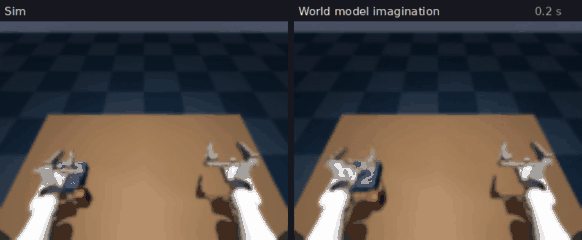
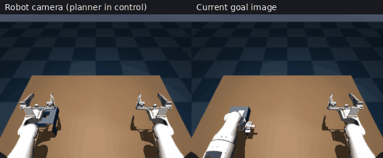

# World model in DINOv2 space for peg pickup (sim)

An action-conditioned world model for the Pioneer left arm in the MuJoCo `peg_insert` scene, in the style of
[DINO-WM](https://arxiv.org/abs/2411.04983): a frozen DINOv2 encoder, a transformer that predicts the next frame's
patch tokens from the last frames and the next actions, and a planner (CEM) that searches for actions whose predicted
future matches goal images. Sim only; nothing here runs on the real arm.

**Status: not working yet.** The model predicts how the arm moves well, but the planner never picked the peg up
(0 of 20 layouts). This is a record of what was tried and measured, so the next attempt can start from here.



Left: a random-motion episode the model never trained on (seed 40002). Right: the world model imagining the same 12 s
from the first two frames and the same actions, decoded to pixels (`imagine.py`). The arm follows the real one; the
peg is blurry and not tracked well.



The planner on one held-out layout: it reaches the peg but never lifts it.

## What was run

| Step | Script | Setting used |
| --- | --- | --- |
| 1. Demos | `synthetic/synthetic_teleop.py --scene peg_insert --record` | 180 synthetic takes, ego camera 320x240 |
| 2. Encode demos | `encode.py` | every 5th frame (5 Hz), DINOv2-small at 224x224, 16x16 or 8x8 tokens of 384 dims |
| 3. Random-motion data | `collect_random.py` | 800 episodes of 12 s from each take's first frame (seeds 30000-30799) |
| 4. Train | `train.py` | 30k iterations, batch 48, about 25 passes over the data; 2 h (16x16) or 35 min (8x8) on an RTX 5070 Ti |
| 5. Plan | `plan_pick.py` | 20 held-out layouts (seeds 9001-9020) |
| Video | `imagine.py` | one new random-motion episode, imagined from its first 2 frames |

The random-motion data drives the gripper with random moves and random open/close, and in half the episodes pulls it
towards the peg. The peg moved in 478 of 800 episodes and was knocked off the table in 453.

## Results

Held-out prediction after 30k iterations (4 steps = 0.8 s ahead; token error is L1 on normalised tokens):

| | 16x16 tokens | 8x8 tokens |
| --- | --- | --- |
| Token error at 0.2 / 0.4 / 0.6 / 0.8 s | 0.145 / 0.155 / 0.160 / 0.165 | 0.144 / 0.155 / 0.163 / 0.169 |
| Same, copying the last frame | 0.178 / 0.209 / 0.230 / 0.246 | 0.169 / 0.198 / 0.220 / 0.238 |
| Arm joint error | 0.009 rad | 0.011 rad |
| Peg height error, peg knocked off | 0.05 cm | 0.17 cm |
| Peg height error, peg lifted | 2.7 cm | 4.1 cm |

Pickup, 20 held-out layouts (peg more than 5 cm above the table at the end):

| | 16x16 | 8x8 |
| --- | --- | --- |
| Hold still | 0 / 20 | 0 / 20 |
| World-model plan | **0 / 20** (highest 0.6 cm on average) | **0 / 20** (highest 0.4 cm) |
| Replay of the synthetic take (upper bound) | 20 / 20 (10.4 cm) | 20 / 20 (10.4 cm) |
| Time per layout | about 9.5 min | about 2.4 min |

What the numbers say:

- **Arm motion is learned.** The joint error is under 1 degree, and the predicted tokens beat copying the last frame
  by about a third at 0.8 s.
- **Lifting is not.** The peg height error when the peg is lifted (2.7-4.1 cm) is a large part of a 5-10 cm lift,
  while falls are predicted almost exactly. The planner needs the lift to be predicted, so it never finds one.
- **Lifts are rare in the data.** In the random-motion data the peg is lifted more than 3 cm in 264 of 48,000 frames
  (45 episodes), and knocked off in 15,814. The demos all lift the peg, but their peg height is not recorded, so the
  peg height output learns lifts only from those 264 frames.
- **16x16 tokens did not help** over 8x8 on any number, at 4x the planning time.

## Differences from DINO-WM

| | DINO-WM paper | Here |
| --- | --- | --- |
| Encoder | frozen DINOv2 patch features | same (DINOv2-small, 384 dims) |
| Frame skip | 5 | 5 (0.2 s per step) |
| Planner | CEM in MPC, one goal image | CEM in MPC, three goal images in a row |
| History | 3 frames (1 in some tasks) | 2 frames |
| Action and arm state input | added to every patch token | one shared token |
| Predictor | ViT with a frame-level causal mask | transformer predicting the next frame as a change from the last |
| Loss | squared L2, teacher forcing | L1 over 4-step rollouts, plus arm state and peg height outputs |
| Training | 100 epochs, predictor lr 5e-5 | about 25 passes, lr 3e-4 |
| Decoder | separate, no gradient into the predictor | same |

## Next steps

In the order I would try them:

1. **More lift examples:** record the peg height in the demos, and add random-motion episodes that start from a
   grasp, so lifts are not 0.6% of the data.
2. **Match the paper:** action tokens on every patch, history 3, squared L2, one goal image, 100 epochs.
3. **Check the goals:** run the planner with ground-truth goal tokens from the same layout to separate a model
   problem from a planner problem.
4. **Train the encoder too**, end to end with a collapse-preventing loss, for example
   [LeWM](https://le-wm.github.io/), which also plans much faster.

## Run

From this folder, in an environment with torch (CUDA), transformers, mujoco, av and pandas. Step 1 needs the
`synthetic/` demo generator; see [`src/teleop/pioneer_leader_arm_teleop/README.md`](../../teleop/pioneer_leader_arm_teleop/README.md).

```bash
# 1. demos (encode.py expects one episode per data file and stops with an error otherwise)
cd ../../teleop/pioneer_leader_arm_teleop
MUJOCO_GL=egl python synthetic/synthetic_teleop.py --scene peg_insert --record --num_episodes 180 \
  --cameras ego --image_size 320x240 --dataset_root /data/peg_insert_320
cd -

# 2-5. TOK = 8 or 16; 16x16 needs --latents-on-cpu for training on a 16 GB GPU
python encode.py /data/peg_insert_320 peg16.pt --tok 16
MUJOCO_GL=egl python collect_random.py random16.pt --tok 16 --first-seed 30000 --episodes 800
python train.py peg16.pt random16.pt wm16 --iters 30000 --latents-on-cpu
MUJOCO_GL=egl python plan_pick.py wm16/wm.pt pick16 --seeds 9001-9020
MUJOCO_GL=egl python imagine.py wm16/wm.pt imagine.mp4 --seed 40002
```

`action_bounds.json` holds the planner's action limits: the range of each joint and the largest change per 0.2 s in
the demos.

**Known issue:** on the current `main`, the synthetic generator fails to grasp in `peg_insert` (and in the other
scenes tried), so steps 1 and 5 do not work until it is updated for the new arm and gripper models. The results above
were recorded on the earlier arm model, before that change. On `main`, steps 2-4 were checked (step 2 with the
earlier demos), and step 5 against the earlier generator.
