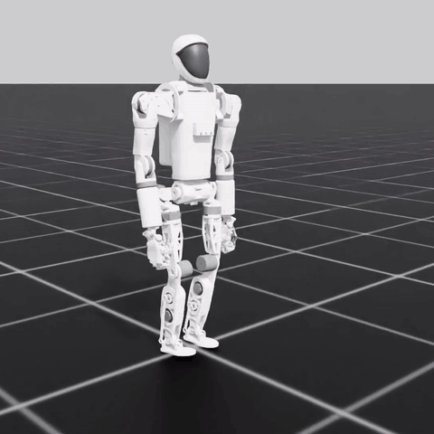
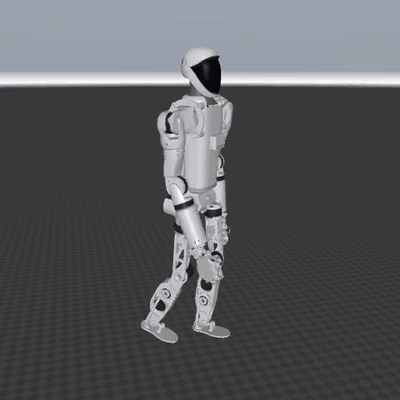
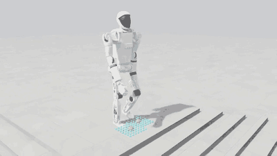

# Pioneer humanoid: walking



Velocity-commanded walking on flat ground for two robots, with the same policy observations and actions:

- leg-only humanoid (`assets/pioneer_leg_only_humanoid`): 12 leg joints, 32.2 kg;
- whole-body humanoid (`assets/pioneer_whole_body_humanoid`): arms, hands and head, 44.7 kg; the policy drives the 12
  leg joints, the shoulders and elbows swing on the gait clock (`arm_swing.py`) with the fists closed, and the rest of
  the upper body is held rigid.

Masses are the URDFs' estimates. Robot configs: `pioneer_humanoid/leg_only.py` and `whole_body.py` (each URDF re-rooted at the hips with
+X forward; the assets' root is at the soles, -Y forward).

| Task | Robot |
|---|---|
| `Isaac-Locomotion-Flat-PioneerLegOnly-v0` | leg-only humanoid |
| `Isaac-Locomotion-Flat-PioneerWholeBody-v0` | whole-body humanoid, scripted arm swing, fists closed |

Each has a `-Play-v0` variant. In the `simulation_isaac` container, from `$HUMANOID_ROOT`:

```bash
rl-train --task=Isaac-Locomotion-Flat-PioneerLegOnly-v0 --headless          # ~1 h for 3000 iterations
rl-play --task=Isaac-Locomotion-Flat-PioneerLegOnly-Play-v0 --num_envs 1 --video --checkpoint <run>/model_<n>.pt
# PLAY_COMMAND="vx,vy,wz" (default "0.5,0,0") or PLAY_COMMAND=random (a new command every 3 s)
```

Trained policies (in `models/`):

```bash
rl-play --task=Isaac-Locomotion-Flat-PioneerLegOnly-Play-v0 --num_envs 1 --video --checkpoint models/pioneer_leg_only_flat/model_2999.pt
rl-play --task=Isaac-Locomotion-Flat-PioneerWholeBody-Play-v0 --num_envs 1 --video --checkpoint models/pioneer_whole_body_flat/model_2299.pt
```

A whole-body run can start from a leg-only checkpoint (same observations and actions): `--resume True --load_run <run> --checkpoint <ckpt>`.

## Rewards

The reward is the weighted sum of these terms, every 20 ms step (`flat_env_cfg.py`; gait terms in `gait.py`).

| Category | Term | Weight | What |
|---|---|---|---|
| Task | `track_lin_vel_xy_exp` | 1.0 | exp(-error² / 0.25) of the commanded x-y velocity (yaw frame) |
| | `track_ang_vel_z_exp` | 0.5 | exp(-error² / 0.25) of the commanded yaw rate |
| | `alive` | 0.15 | per step not fallen |
| Gait | `contact` | 0.18 | feet (0-2) whose ground contact matches the clock: stance for the first 55% of each leg's 1 s cycle, legs half a cycle apart |
| | `feet_swing_height` | -20 | squared error of each airborne sole from 10 cm |
| | `contact_no_vel` | -0.2 | squared velocity of planted feet (slip) |
| | `stance_knee` | -1.0 | squared distance of a stance knee from -0.15 rad (near-straight supporting leg) |
| | `feet_flat` | -2.0 | squared tilt of planted feet (land on the sole, not its edge) |
| | `feet_too_close` | -40 | squared amount the feet come closer than 0.2 m sideways or cross |
| Posture | `base_height` | -10 | squared error of base height from 0.835 m |
| | `flat_orientation_l2` | -1.0 | squared base tilt |
| | `hip_pos` | -1.0 | squared hip roll and yaw angles |
| Smoothness | `lin_vel_z_l2` | -2.0 | squared base vertical velocity |
| | `ang_vel_xy_l2` | -0.05 | squared base roll and pitch rates |
| | `dof_vel` | -1e-3 | squared joint velocities |
| | `dof_acc_l2` | -2.5e-7 | squared hip and knee accelerations |
| | `dof_torques_l2` | -2e-6 | squared hip and knee torques |
| | `action_rate_l2` | -0.02 | squared change of the action |
| Limits | `dof_pos_limits` | -5.0 | joint angles beyond 90% of their range |
| | `termination_penalty` | -200 | episode ends by a fall (base touches the ground) |

Randomised for transfer: friction 0.3-1.2, base mass -1 to +3 kg, base centre of mass ±3 cm, motor stiffness and damping
×0.7-1.3, joint armature ×0.5-2, pushes up to 0.8 m/s every 5-10 s, start pose ±0.1 rad.
PPO trains every batch also on its left-right mirror image (`symmetry.py`), for an even gait.

## Sim2sim in MuJoCo



`sim2sim_mujoco.py` runs a checkpoint on the same robot in MuJoCo: same URDF, gains, torque limits, observation and arm
swing, no Isaac Lab needed (Python with `mujoco`, `torch`, `numpy`; `imageio` for `--video`). From the repo root:

```bash
python src/simulation/humanoid_rl_tasks/humanoid_rl_tasks/locomotion/config/pioneer/sim2sim_mujoco.py \
    models/pioneer_whole_body_flat/model_2299.pt --whole_body --vx 0.5 --video walk.mp4
# leg-only: models/pioneer_leg_only_flat/model_2999.pt without --whole_body
# --vy, --wz: other commands; --seed N: a perturbed start; --push 0.5: a random shove every 3 s
```

It prints the distance and mean speed, or the time of a fall. Both trained policies, 10 s each (mean forward speed):

| Command | leg-only | whole-body |
|---|---|---|
| 0.3 m/s | 0.30 | 0.29 |
| 0.5 m/s | 0.48 | 0.47 |
| 0.8 m/s | 0.74 | 0.76 |
| 0.3 m/s + turn 0.6 rad/s | 0.30 | 0.29 |
| sideways 0.3 m/s | 0.18 lateral | 0.20 lateral |

No falls, also with `--seed 0..4 --push 0.5` for 20 s at 0.5 m/s.

## Running (recipe, not a registered task)

The whole-body flat task runs with these changes, fine-tuned ~2000 iterations from the walking policy:

| Setting | Walk | Run |
|---|---|---|
| `gait.py` `PERIOD` / `STANCE` / `SWING_HEIGHT` | 1.0 s / 0.55 / 0.10 m | 0.6 s / 0.35 / 0.12 m (both feet off the ground between steps) |
| commands `lin_vel_x` / `lin_vel_y` / `rel_standing_envs` | 0-1.0 / +-0.5 / default | 0.6-1.8 / +-0.3 / 0 |
| `arm_swing` amplitude / full_speed / elbow_bend | 0.35 / 0.8 / 0.3 | 0.6 / 1.6 / 1.2 |
| `track_lin_vel_xy_exp` weight | 1.0 | 1.5 |
| `stance_knee` weight | -1.0 | -0.3 |
| `base_height` target | 0.835 m | 0.80 m |

Result in Isaac Lab: 1.20 / 1.48 / 1.78 m/s at 1.2 / 1.5 / 1.8 m/s commands, no falls; hip and knee at their 3.67 rad/s
limit 40-47% of the time, so check the real motors before trying it on the robot. Trained with the 65 deg knee range.

## Uneven ground

`rough_env_cfg.py`, the flat recipe on generated terrain with a terrain curriculum, tracking weighted up (1.5, std 0.35)
and the swing height measured from the lower foot instead of z = 0:

| Task | Terrain | Observation | Trained policy |
|---|---|---|---|
| `Isaac-Locomotion-RoughBlind-PioneerLegOnly-v0` | mild: bumps, 2-8 cm boxes, gentle slopes, 3-8 cm steps | the flat task's (blind) | `models/pioneer_leg_only_rough_blind/model_3999.pt` |
| `Isaac-Locomotion-RoughPerceptive-PioneerLegOnly-v0` | Isaac Lab's rough course: stairs up to 23 cm | + 1.6 x 1.0 m height scan (187 rays) | `models/pioneer_leg_only_rough_perceptive/model_3500.pt` |

The blind policy needs no terrain sensor, so it runs on the robot as it is, and `sim2sim_mujoco.py` runs it unchanged
(flat MuJoCo: 0.27 / 0.47 / 0.77 m/s at 0.3 / 0.5 / 0.8, no falls in 5 pushed 20 s runs).

Stairs, 1000 robots per policy, 0.5 m/s for 20 s, started in a stair pit (up) or on a pyramid (down); share past the
last step:

| Step height | blind: up | blind: down | perceptive: up | perceptive: down |
|---|---|---|---|---|
| 4-7 cm | 100% | 100% | | |
| 8-10 cm | | | 11% | 100% |
| 10-20 cm | | | 0% | 98-100% |

The perceptive policy walks down stairs but does not climb above ~10 cm. Both were trained with a 65 deg knee range;
the numbers above are with the current URDF (140 deg).

`Isaac-Locomotion-RoughFoothold-PioneerLegOnly-v0` (`foothold_env_cfg.py`, `foothold.py`, `foot_pred/`) is the
perceptive task with foothold-conditioned perception: instead of the whole height map the policy sees a 7 x 7 height
patch (5 cm cells) around each of the two footholds a small predictor expects next; the predictor is refit every 500
iterations. Trained policy: `models/pioneer_leg_only_rough_foothold/model_3999.pt` (with its foot predictor
`foot_model_3505.pt`, started from the blind policy). Same stair test: 8-9% up at 8-13 cm, 0-1% above, 96-100% down.

Height scan vs foothold from the same start (the blind policy), 5000 iterations each on a stair-heavy course (45% stair
pits, not included here), same stair test, best checkpoint of each, share out of the pit:

| Step height | height scan | foothold |
|---|---|---|
| 8-10 cm | 28% | 51% |
| 10-13 cm | 9% | 38% |
| 13-15 cm | 3% | 19% |

Foothold climbs better. Climbing steps above ~10 cm still needs work.



`Isaac-Locomotion-RoughFoothold-PioneerWholeBody-v0` is the foothold task on the whole-body humanoid with the flat
task's arm swing; the policy still sees and drives only the 12 leg joints. Trained policy:
`models/pioneer_whole_body_rough_foothold/model_4500.pt`, fine-tuned 500 iterations from the leg-only foothold policy
(same foot predictor). Stair test: 16% up at 8-10 cm, 3% at 10-13 cm, 0% above, 98-100% down.
`Isaac-Locomotion-RoughFoothold-PioneerWholeBody-Demo-v0` walks one robot through one tile of each obstacle in a row
(`DEMO_DIFFICULTY`, default 0.1 = 7 cm stairs; `DEMO_SPEED`, default 0.5 m/s); at the defaults it crosses all six (42 m)
without falling.
In the foothold Play and Demo tasks, `SHOW_FOOTHOLDS=1` draws the height patches the policy sees and its predicted
footholds.

## Policy interface (for deployment)

50 Hz. Observation (50): base linear velocity of the base's centre of mass and angular velocity, both in the base frame
(3 + 3), projected gravity (3), command vx, vy, wz (3), joint positions minus default (12), joint velocities (12), last
action (12), gait clock sin, cos of 2π·(t mod 1 s) (2). Action (12): joint target = default + 0.25 · action. Joint order:
`Hip_F_L Hip_F_R Hip_A_L Hip_A_R Hip_R_L Hip_R_R Knee_L Knee_R Ankle_P_L Ankle_P_R Ankle_R_L Ankle_R_R`. Default pose:
Hip_F 0.25, Knee -0.5, Ankle_P -0.25 rad, the rest 0. PD gains: Hip_F/Knee 200, Hip_A/Hip_R 150, ankles 40; damping 5
(ankles 2).

## Notes

- Sideways walking is slow (~0.2 m/s for 0.3): the hip can swing a leg only 10° inward.
- `gait.py` zeroes non-finite rewards (a rare PhysX glitch otherwise turned training into NaNs at a random iteration) and
  `physics_blowup` resets such robots.
